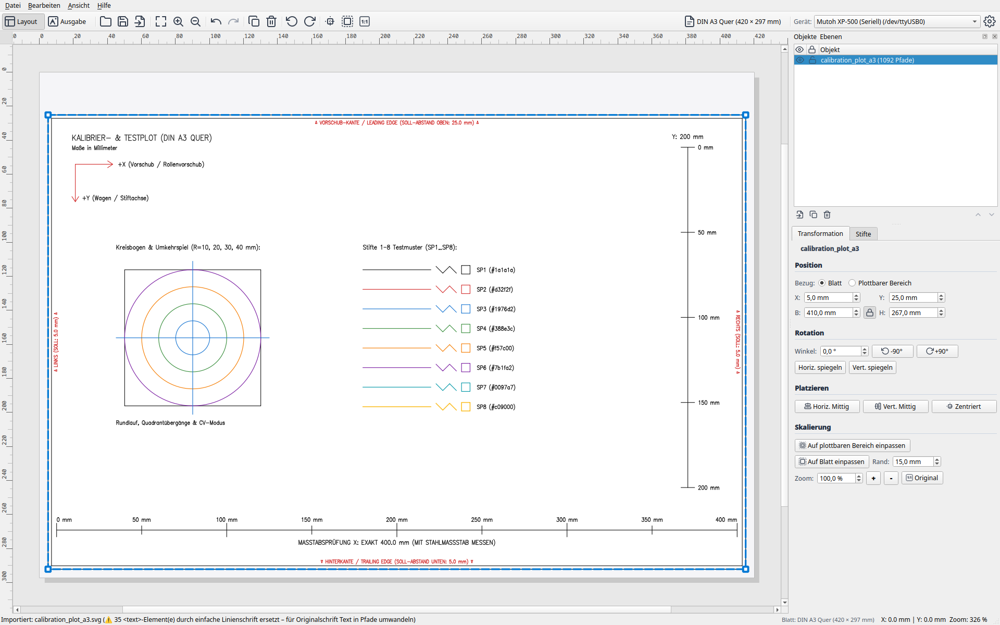
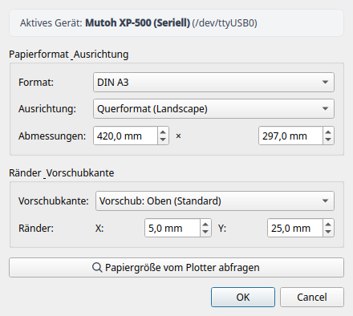
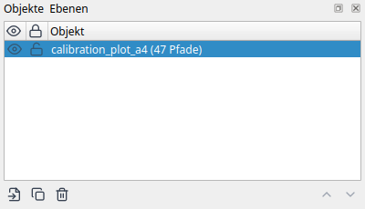
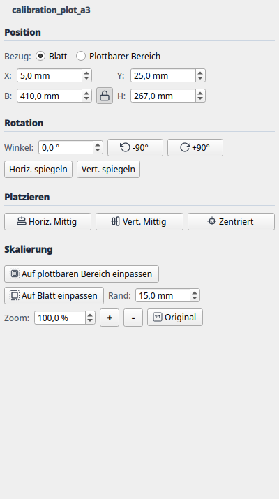

# 2. Layout-Modus & Objektverwaltung

Der **Layout-Modus** ist die kreative Schaltzentrale von Plotter Studio. Hier arrangieren, skalieren und drehen Sie Ihre Vektorgrafiken auf dem gewählten Papierformat, weisen Stifte und Farben zu und prüfen die Abstände zu den Randbereichen des Plotters.

---

## 1. Aufbau der Benutzeroberfläche

Die Arbeitsumgebung ist übersichtlich in funktionale Bereiche unterteilt:

1. **Haupt-Canvas (Mitte):**
   * Zeigt das gewählte Papierblatt maßstabsgetreu in Millimetern an.
   * Ein **roter/gestrichelter Innenrahmen** markiert den physisch plottbaren Bereich (das sogenannte *Hard-Clip-Fenster*). Liegen Vektoren außerhalb dieses Rahmens, warnt Plotter Studio vor möglichem Beschnitt.
   * **Lineale (oben und links):** Zeigen präzise Millimeterangaben. Der Nullpunkt (0, 0) liegt an der oberen linken Ecke des Papiers.
   * **Maus-Navigation:**
     * **Mausrad:** Zoomt stufenlos hinein und heraus (zentriert auf den Mauszeiger).
     * **Mittlere Maustaste gedrückt halten:** Verschiebt den Bildausschnitt (Pan).
     * **Linke Maustaste:** Selektiert Objekte und ermöglicht direktes Verschieben per Drag & Drop.

2. **Geräte- & Statusleiste (oben):**
   * Schnellauswahl des aktiven Plotters (z.B. *Mutoh XP-500 (Seriell)* oder *Generic HP-GL*).
   * Verbindungsstatus und Schnelltasten für **Seiteneinrichtung** und **Geräte-Einstellungen**.
   * Modus-Umschaltung zwischen **Layout-Modus** und **Ausgabe-Modus** (Plot-Vorschau).

3. **Rechte Werkzeug-Docks:**
   * **Dock "Objekte & Ebenen":** Baumansicht aller geladenen Dokumente, Gruppen und Pfade.
   * **Dock "Transformation":** Numerische Steuerung für Position, Größe, Drehung und Skalierung.
   * **Dock "Stifte & Farben":** Verwaltung der Stiftpalette und Zuordnung der Zeichenwerkzeuge.

---

## 2. Blatt- & Seiteneinrichtung

Vor dem Platzieren von Grafiken sollten Sie das gewünschte Blattformat und Randprofil festlegen. Klicken Sie in der Werkzeugleiste auf **[ 📄 Seiteneinrichtung... ]**.

### Einstellungsoptionen im Dialog:
* **Standard-Formate:** Schnellauswahl aus DIN A4, A3, A2, A1 und A0.
* **Benutzerdefiniert:** Freie Eingabe von Breite und Höhe in Millimetern (z.B. für Sonderformate oder Zuschnitte von der Papierrolle).
* **Ausrichtung:** Umschaltung zwischen **Hochformat (Portrait)** und **Querformat (Landscape)**.
* **Randprofil (Margin Profile):**
  * *EXP (Expanded):* Minimale Ränder für maximale Zeichenfläche (Standard beim Mutoh XP-500: 25 mm Einzug, 5 mm an den anderen drei Seiten).
  * *NORM (Normal):* Größere Sicherheitsabstände (35 mm / 15 mm).
  * *TYPE1 / TYPE3:* Spezialprofile für Rollenpapier.
* **🔍 Plotter abfragen (Live-Hard-Clip):**
  Ist ein Plotter per RS-232 oder Netzwerk verbunden, fragt dieser Button über den HP-GL-Befehl `OH;` die exakten Grenzen des aktuell eingespannten Papiers direkt von den optischen Sensoren der Hardware ab. Format und Maße werden automatisch übernommen.

---

## 3. Vektorgrafiken importieren

Plotter Studio verwendet standardmäßig **SVG (Scalable Vector Graphics)** als universelles Import- und Layoutformat:
* **SVG:** Der moderne Standard für Vektorgrafiken aus Inkscape, Adobe Illustrator, Affinity Designer, Figma oder CAD-Exporten.
* *(Hinweis zu HP-GL / PLT: HP-GL ist das primäre Ausgabe- und Exportformat von Plotter Studio. Der direkte Re-Import alter HP-GL-Plotdateien befindet sich auf der Roadmap für künftige Versionen.)*

### Import-Möglichkeiten:
1. **Drag & Drop:** Ziehen Sie eine `.svg`-Datei direkt aus dem Dateimanager in das Canvas-Fenster.
2. **Menü:** Wählen Sie **Datei ➔ Öffnen...** (`Strg+O`) oder **Datei ➔ Importieren...** (`Strg+I`).

### Automatisches Farb-Clustering
Beim Import analysiert Plotter Studio alle Strichfarben (Strokes) in der Datei und ordnet sie über einen Farbabstands-Algorithmus (Delta-E im Lab-Farbraum) automatisch den verfügbaren Stiften (1–8) zu. Pfade gleicher Farbe werden logisch gruppiert.

---

## 4. Dock "Objekte & Ebenen" (Z-Order)

Das Dock **Objekte & Ebenen** listet alle geladenen Zeichnungselemente hierarchisch auf.

### Funktionen und Bedienelemente:
* **Sichtbarkeit (Auge-Symbol):** Schaltet ein Objekt oder eine Ebene unsichtbar. Unsichtbare Objekte werden weder im Canvas gerendert noch an den Plotter gesendet.
* **Sperren (Schloss-Symbol):** Schützt das Objekt vor versehentlichem Verschieben oder Transformieren im Canvas.
* **Z-Reihenfolge (Zeichenabfolge):**
  * Objekte, die in der Liste weiter oben stehen, werden im Canvas über den darunter liegenden Objekten dargestellt.
  * Über die Schaltflächen **[ ▲ Nach oben ]** und **[ ▼ Nach unten ]** (oder per Drag & Drop in der Liste) können Sie die Reihenfolge ändern.
  * *Praxistipp:* Bestimmen Sie so, welche Stiftfarben oder Detailzeichnungen zuerst gezeichnet werden (z.B. Hintergrundschraffuren vor Vordergrundkonturen).
* **Verwaltung:**
  * **[ 📄 Duplizieren ]:** Erstellt eine identische Kopie des ausgewählten Objekts.
  * **[ 🗑️ Löschen ] (`Entf`):** Entfernt das Objekt aus dem Dokument.

---

## 5. Dock "Transformation"

Das Dock **Transformation** erlaubt die millimetergenaue Positionierung und Skalierung von Objekten.

### Koordinaten & Abmessungen:
* **X / Y (mm):** Legt die Position des Ankerpunkts (oben links) auf dem Blatt fest.
* **Breite / Höhe (mm):** Exakte Zielgröße des Objekts.
* **Skalierungsfaktor (%):** Relative Größenänderung in Prozent.
* **Seitenverhältnis sperren (🔗 Schloss-Symbol):**
  * *Aktiviert (geschlossen):* Änderungen an Breite oder X-Skalierung passen Höhe und Y-Skalierung automatisch proportional an.
  * *Deaktiviert (geöffnet):* Erlaubt verzerrtes Skalieren in nur eine Achsenrichtung.

### Schnelltasten & Ausrichtung:
* **[ 50 % ] / [ 100 % ] / [ 200 % ]:** Schnelle Skalierung auf halbe, originale oder doppelte Größe mit einem einzigen Klick.
* **[ 🎯 Auf Blatt einpassen ]:** Skaliert das gewählte Objekt proportional so groß wie möglich, sodass es die plottbare Fläche (Hard-Clip-Fenster) optimal ausnutzt.
* **[ ⊕ Auf Blatt zentrieren ]:** Verschiebt das Objekt exakt in die geometrische Mitte des Papiers.

### Drehung & Spiegelung:
* **Winkel (°):** Schnelltasten für **0°**, **90°**, **180°**, **270°** sowie freie Eingabe.
* **Spiegeln:**
  * **[ ↔ Horizontal spiegeln ]:** Spiegelt das Objekt an der vertikalen Mittelachse.
  * **[ ↕ Vertikal spiegeln ]:** Spiegelt das Objekt an der horizontalen Mittelachse.

---

## 6. Stiftpalette & Farbzuweisung

Unten im Fenster oder im Stift-Dock finden Sie die 8 Stiftkanäle des Plotters:

| Stift | Standardfarbe | Empfohlene Stiftart | Verwendung |
|---|---|---|---|
| **Stift 1** | Schwarz (`#000000`) | Fineliner 0,3 mm | Hauptkonturen, Beschriftung |
| **Stift 2** | Rot (`#E53935`) | Fineliner 0,3 mm | Hervorhebungen, Bemaßung |
| **Stift 3** | Blau (`#1E88E5`) | Fineliner 0,3 mm | Hilfslinien, Schraffuren |
| **Stift 4** | Grün (`#43A047`) | Fineliner 0,5 mm | Sekundäre Geometrie |
| **Stift 5** | Orange (`#FB8C00`) | Filzstift / Pinsel | Flächenschraffur |
| **Stift 6** | Magenta (`#8E24AA`) | Fineliner 0,1 mm | Feine Details |
| **Stift 7** | Cyan (`#00ACC1`) | Kugelschreiber | Entwürfe |
| **Stift 8** | Gelb (`#FDD835`) | Marker | Füllungen |

Durch Rechtsklick auf ein Objekt im Canvas oder Auswahl im Stifte-Dock kann jedem Pfad jederzeit eine andere Stiftnummer zugewiesen werden.
