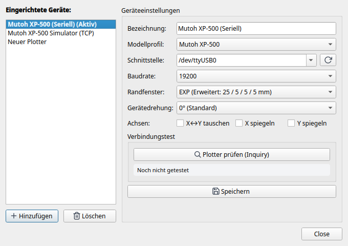

# 4. Hardware-Setup, Kalibrierung & Diagnose

Hier erfährst du, wie du deinen Stiftplotter physikalisch mit dem Computer verbindest, die Schnittstellenparameter und Panel-Einstellungen konfigurierst, die Verbindung mit dem integrierten Diagnosetool testest, den offiziellen Kalibrierplot durchführst und beliebige weitere Plottermodelle einbindest.

---

## 1. Physischer Anschluss & Verkabelung

Klassische Plotter nutzen serielle RS-232-Schnittstellen (meist 25-polige DB-25-Buchsen oder 9-polige DB-9-Buchsen). Moderne Computer verfügen in der Regel über keine nativen COM-Ports mehr, weshalb ein USB-zu-Seriell-Adapter verwendet wird.

### Empfohlene USB-Seriell-Adapter
* **Chipsatz:** Verwende Adapter mit Original-Chipsätzen von **FTDI** (z.B. FT232R, FT2232) oder **Silicon Labs** (CP2102).
* **Vorsicht:** Billige Nachbauten ohne echten RTS/CTS-Hardware-Handshake führen bei größeren Vektordaten unweigerlich zu Pufferüberläufen und Datenverlust.

### Nullmodem-Verkabelung mit echtem Hardware-Handshake
Für eine zuverlässige Kommunikation ist ein vollbeschaltetes Nullmodem-Kabel (Cross-Over) zwingend erforderlich:

| Signal | PC-Seite (DB-9 Buchse) | Plotter-Seite (DB-25 Stecker) | Plotter-Seite (DB-9 Stecker) | Beschreibung |
|---|---|---|---|---|
| **RxD** (Empfang) | Pin 2 | Pin 2 (TxD) | Pin 3 (TxD) | Empfangsdatenleitung |
| **TxD** (Senden) | Pin 3 | Pin 3 (RxD) | Pin 2 (RxD) | Sendedatenleitung |
| **GND** (Masse) | Pin 5 | Pin 7 (GND) | Pin 5 (GND) | Signalmasse |
| **RTS** (Request to Send) | Pin 7 | Pin 5 (CTS) | Pin 8 (CTS) | PC signalisiert Empfangsbereitschaft |
| **CTS** (Clear to Send) | Pin 8 | Pin 4 (RTS) | Pin 7 (RTS) | **Plotter steuert Datenfluss (Handshake)** |
| **DTR** (Data Terminal Ready)| Pin 4 | Pin 6 (DSR) | Pin 6 (DSR) | Betriebsbereitschaft |
| **DSR** (Data Set Ready) | Pin 6 | Pin 20 (DTR) | Pin 4 (DTR) | Betriebsbereitschaft |

> **Wichtig:** Eine einfache 3-Draht-Verbindung (nur TxD, RxD, GND) ohne RTS/CTS funktioniert bei Stiftplottern nicht sicher, da der Plotter bei komplexen Kurvenfahrten den PC anhalten können muss.

### Alternative: TCP / Ethernet Device Server
Statt eines USB-Kabels kannst du auch Serial-to-Ethernet-Boxen (z.B. Moxa NPort, USR-TCP232) oder einen Raspberry Pi mit `socat` verwenden. Plotter Studio unterstützt TCP-Sockets nativ über die Portangabe `tcp://<IP-Adresse>:<Port>` (z.B. `tcp://192.168.1.150:4001`).

---

## 2. Bedienfeld- und Panel-Setup (Beispiel Mutoh XP-500)

Stelle am Bedienfeld oder den DIP-Schaltern des Plotters folgende Parameter ein:

* **Emulation:** HP-7585B oder MH-GL.
* **Baudrate:** `19200` Baud (oder `9600` Baud bei langen Kabelwegen).
* **Datenformat:** `8` Datenbits, `keine` Parität (None), `1` Stoppbit (**8N1**).
* **Handshake / Flow Control:** **Hardware (RTS/CTS)**. *XON/XOFF muss deaktiviert sein*.
* **Randmodus (Margin Profile):** **EXP** (Expanded).
* **Papiereinzug:** Nach dem Einlegen des Papiers liest der optische Sensor die Ränder automatisch ein.

---

## 3. Hardware-Diagnose mit `tools/xp500_probe.py`

Plotter Studio liefert ein eigenständiges Terminal-Diagnosewerkzeug mit, mit dem du die Schnittstelle und alle Rückmeldungen auf Bit- und Byte-Ebene prüfen kannst:

```bash
# Aufruf über USB-Seriell:
python3 tools/xp500_probe.py /dev/ttyUSB0

# Aufruf mit Baudrate und detaillierten ESC-Sequenzen:
python3 tools/xp500_probe.py /dev/ttyUSB0 --baudrate 19200 --esc

# Aufruf über Netzwerk / TCP-Server:
python3 tools/xp500_probe.py tcp://127.0.0.1:9999
```

### Typische Ausgabe bei fehlerfreier Verbindung:
```
============================================================
Plotter Studio - Hardware Diagnostic Probe
Target: /dev/ttyUSB0 (19200 baud, 8N1, RTS/CTS)
============================================================
[1/4] Checking Hardware Control Lines (RS-232)...
  CTS line : True  (Plotter is ready to accept data)
  DSR line : True  (Plotter hardware present)

[2/4] Querying Plotter Identification...
  Command 'OI;' -> Response: '7585B' (HP-7585B emulation active)

[3/4] Querying Resolution & Scaling Factors...
  Command 'OF;' -> Response: '40,40' (40 Plotter-Units per mm = 0.025 mm/step)

[4/4] Querying Plottable Window (Hard-Clip)...
  Command 'OH;' -> Response: '-8200,-5340,8200,5340'
  Calculated printable area: 410.0 mm x 267.0 mm (Matches DIN A3)

Result: Plotter is ONLINE, RESPONSIVE and READY FOR PLOTTING!
```

Erscheint hier ein Timeout, überprüfe die Leitungen CTS/RTS und die Baudrate am Plotterbedienfeld.

---

## 4. Der Kalibrierplot (Genauigkeit, Ränder, Stifte & Backlash)

Im Verzeichnis `resources/` liegen vorbereitete Kalibriermuster für DIN A4 und DIN A3 bereit:
* `resources/calibration_plot_a3.svg` / `.hpgl`
* `resources/calibration_plot_a4.svg` / `.hpgl`


### Aufbau und Prüfkriterien des Testmusters:

1. **Orientierungs-Pfeile (+X / +Y) & Kantenmarkierung:**
   * An der Einzugskante ist der Pfeil `+Y` und der Schriftzug `TOP / LEADING EDGE` aufgedruckt.
   * *Prüfung:* Wurde die Schrift kopfstehend oder gespiegelt gezeichnet? Falls ja, muss im Geräteprofil `invert_x`, `invert_y` oder `rotation_deg` angepasst werden.
2. **Präzisions-Messstrecke (400 mm bei A3 / 200 mm bei A4):**
   * Eine lange durchgezogene Messlinie mit präzisen Endstrichen.
   * *Prüfung:* Miss die gezeichnete Linie mit einem hochwertigen **Stahllineal** nach.
   * Ist die Linie z.B. exakt 400,0 mm lang, arbeitet die Schrittmotorübersetzung perfekt mit 40,0 Units/mm. Bei Abweichungen kann der Faktor im Geräteprofil (`units_per_mm`) feinjustiert werden.
3. **Äußerer Begrenzungsrahmen (Hard-Clip Check):**
   * Zeichnet ein Rechteck genau an den äußersten plottbaren Grenzen des Papiers.
   * *Prüfung:* Werden alle 4 Kanten sauber gezeichnet, ohne dass der Stift auf die Gummiwalzen läuft oder der Kopf an mechanische Begrenzer schlägt?
4. **8-Stifte-Matrix:**
   * 8 beschriftete Testboxen mit Farbstreifen.
   * *Prüfung:* Funktioniert das automatische Ein- und Auswechseln aller Stifte aus dem Karussell fehlerfrei? Schließen die Stiftkappen dicht?
5. **Konzentrische Kreise & Quadrat-in-Kreis (Umkehrspiel / Backlash):**
   * Feine konzentrische Kreise und ein exakt zentriertes Quadrat.
   * *Prüfung:*
     * Treffen die Anfangs- und Endpunkte der Kreislinien exakt aufeinander?
     * Sind Kreise kreisrund oder leicht eiförmig/elliptisch?
     * Ein Versatz an den Quadranten deutet auf mechanisches Spiel (Backlash) im Riemenantrieb oder den Andruckrollen hin.

---

## 5. Anbindung weiterer Plottermodelle

Plotter Studio beschränkt sich nicht auf den Mutoh XP-500. Du kannst beliebige Plotter in der Konfiguration hinzufügen.

### Dialog "Geräte-Einstellungen"

Öffne über die obere Leiste oder das Menü **Geräte -> Einstellungen...** den Konfigurationsdialog:



* **Plotter-Liste:** Zeigt alle hinterlegten Geräte an.
* **[ Neues Gerät ]:** Legt ein neues Profil an.
* **Einstellungen pro Gerät:**
  * **Anzeigename:** z.B. `Roland DXY-1150 Flachbett`.
  * **Geräteprofil:** Auswahl des Hardware-Grundtyps (z.B. `mutoh_xp500` oder `hpgl_generic`).
  * **Schnittstelle & Baudrate:** Serieller Port oder Netzwerkadresse.
  * **Randprofil:** Gewünschtes Standard-Margin-Profil.

### Eigene Geräteprofile als YAML anlegen
Geräteprofile werden unter `resources/devices/<name>.yaml` gespeichert. Du kannst einfach eine neue Profildatei anlegen:

```yaml
model_id: "roland_dxy"
name: "Roland DXY-1300 Flachbett"
manufacturer: "Roland DG"
emulation: "HP-GL / RD-GL"
protocol: "hpgl"
origin: "bottom_left"          # Flachbettplotter: Ursprung unten links
units_per_mm: 40.0             # Auflösung: 0,025 mm pro Schritt
max_pens: 8                    # 8-Stift-Wechsler
swap_xy: false
invert_x: false
invert_y: false
rotation_deg: 0

connection:
  baudrate: 9600
  bytesize: 8
  parity: "N"
  stopbits: 1
  rtscts: true
  xonxoff: false

margins_mm:
  default:
    top: 8.0
    bottom: 8.0
    left: 8.0
    right: 8.0

default_margin_profile: "default"
```

Sobald die Datei im Verzeichnis `resources/devices/` abgelegt ist, steht das neue Modell sofort im Dialog und in der Werkzeugleiste von Plotter Studio zur Verfügung. Eine vollständige Beschreibung aller unterstützten YAML-Felder (inkl. `auto_pen_force`, `max_speed_mm_s`, `force_unit` usw.) findest du unter **[Gerätedefinitionen (`docs/devices/geraetendefinition.md`)](../devices/geraetendefinition.md)**.

### Geräte-Import aus InkCut

Plotter Studio liefert ein Import-Werkzeug mit, mit dem du alle HP-GL-Gerätetreiber aus einer InkCut-Installation (`manifest.enaml`) direkt in gebrauchsfertige Plotter-Studio-Profile konvertieren kannst:

```bash
# Geräte aus InkCut einlesen und auflisten:
python3 tools/import_inkcut_devices.py --list-only

# Profile nach resources/devices/ konvertieren:
python3 tools/import_inkcut_devices.py
```

Plotter Studio bringt bereits über 25 vorinstallierte Profile für Modelle von Roland (Stika SV-8/12/15, CAMM-1), Graphtec (CE5000), US Cutter (Refine MH-721/1351), Secabo, Summa, Sekonic und weitere mit.

> **Hinweis zu Schneideplottern (Cutter):** Viele dieser aus InkCut übernommenen Modelle sind Schneideplotter. Sie funktionieren in Plotter Studio hervorragend mit einem Stifteinsatz als Zeichenplotter. Das Schneiden von Folien mit Messerklingen wird noch nicht unterstützt, da die dafür notwendige Schleppmesser-Offset-Kompensation noch in Entwicklung ist.
