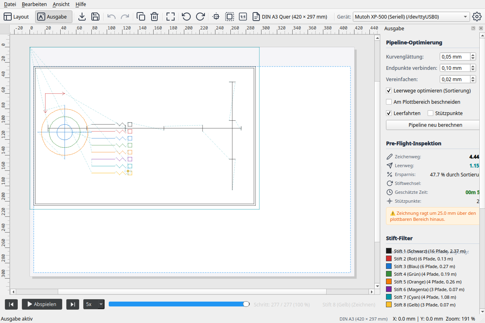
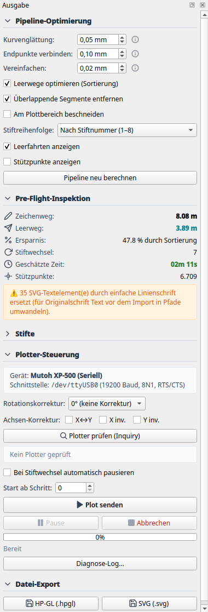

# 3. Output Mode, Simulation & Export

In **Output Mode** (Plot Mode), your artwork is compiled for physical hardware. You can inspect optimized toolpaths including pen-up air moves, simulate the plot along an interactive timeline, check travel savings, and stream the job directly to the plotter or export it to disk.



---

## 1. Optimization Pipeline (Tuning)

At the top of the **Output** dock, you can configure the algorithms that turn raw vector geometries into efficient machine moves (collapsible by clicking the section header):



* **Merge Collinear / Adjacent Paths:**
  Finds open endpoints within close proximity and joins them into continuous polylines.
  * *Tolerance slider (mm):* Maximum distance between two points to be considered connected (default: 0.1 mm).
  * *Effect:* Prevents redundant pen lifts; lines are drawn in smooth, unbroken strokes.
* **Reverse Paths:**
  Allows the pipeline to reverse the direction of a line if the previous stroke ended closer to its end than its start.
* **RDP Simplification (Ramer-Douglas-Peucker):**
  Filters out redundant vertices along straight or evenly curved lines.
  * *Tolerance slider (mm):* Typically 0.05 to 0.1 mm.
  * *Effect:* Produces leaner data streams, reduces load on the plotter's CPU, and results in smoother motor movement without stuttering.
* **Path Optimization (2-Opt TSP):**
  Solves the Traveling Salesperson Problem for toolpath ordering. Permutes lines to minimize non-drawing travel distance (`Pen Up`).
* **[ Apply Pipeline ]:**
  Recomputes all optimizations, updating the canvas visualization and pre-flight metrics.

---

## 2. Pre-Flight Inspection & Metrics

Before sending a plot, the pre-flight analysis provides accurate job data:

| Metric | Typical Value | Description |
|---|---|---|
| **Drawn Distance** | `12.85 m` | Actual distance traveled with pen down on paper (`Pen Down`). |
| **Air Travel Distance** | `3.42 m` | Rapid travel distance with pen lifted (`Pen Up`). |
| **Travel Savings** | `+54.2%` | Travel reduction compared to unoptimized raw SVG data achieved via 2-Opt. |
| **Pen Swaps** | `4` | Number of tool changes in the pen carousel. |
| **Estimated Runtime** | `3m 45s` | Estimated duration based on plotter speed parameters. |

---

## 3. Timeline Simulation with the Scrubber

Located directly below the main canvas is the interactive **simulation bar**:

```
[ Play ]  [ Step Back ]  [ Step Forward ]  ===●====================== 35 %   [ 5x ]
```

### Canvas Visualization in Output Mode:
* **Colored Lines:** Trace drawn vectors in their assigned pen colors.
* **Cyan Dashed Lines:** Represent **rapid travel moves** (`Pen Up`), showing exactly how the pen jumps between elements.
* **Yellow / Orange Markers:** Highlight pen-down and pen-up positions.
* **Toolhead Cursor (Crosshair):** Displays the pen's exact coordinates at the current simulation timestamp.

### Simulation Controls:
* **Scrubber Slider:** Drag the slider to scrub through the plot job forward or backward at any speed.
* **[ Play ] / [ Pause ]:** Start or pause real-time playback animation.
* **Speed Selector:** Toggle between **1x**, **2x**, **5x**, and **10x** playback speeds.
* **Step Controls:** Inspect critical corners and intricate details vector by vector.

---

## 4. Selective Plotting (Pen Filtering)

In the **Pens** section of the Output dock, each pen has its own toggle checkbox:

* **Enable / Disable Pen:**
  * Unchecking a pen excludes its lines from the current plot job.
* **Typical Use Cases:**
  * **Manual Pen Swaps:** If your plotter only has a single pen holder, uncheck all pens except Pen 1. Once finished, swap the physical pen, enable Pen 2, and plot the next layer.
  * **Dry Runs & Test Plots:** Plot only outline frames or fine hatching to test alignment before committing to a full multi-pen drawing.

---

## 5. Live Plotting on Hardware

The **Plotter Connection & Output** section controls physical communication:

### Step 1: Connection & Inquiry
1. Select the target interface (e.g. `/dev/ttyUSB0` on Linux, `COM3` on Windows, or `tcp://...`).
2. Click **[ Probe Plotter (Inquiry) ]**.
3. Plotter Studio sends `OI;` (model query) and `OH;` (hard-clip query) to the device.
4. On success, the status banner lights up green:  
   `7585B (A3, 40 U/mm) • Hard-Clip: 390x287 mm`.

### Step 2: Start Plot
* Click **[ Send Plot ]**.
* The job streams in the background via `SerialStreamer`.
* A progress bar indicates transmitted percentage.
* On the canvas, the toolhead cursor moves synchronously with the physical pen head.

### Step 3: Pause or Emergency Abort
* **[ Pause ] / [ Resume ]:** Pauses command transmission immediately (e.g. to inspect ink or adjust paper) and resumes seamlessly.
* **[ Cancel ]:** Triggers an emergency stop:
  1. Immediately transmits `\x1b.K` to flush the device buffer.
  2. Lifts the pen (`PU;`).
  3. Parks the pen safely in the carousel (`SP0;`).

---

## 6. File Export

To archive optimized plots or run them from a separate controller:

* **[ Export Plot File (.hpgl)... ]:**
  Generates a clean, standard HP-GL/PLT machine file. Coordinates and pen calls are mapped to the chosen device profile.
* **[ Export Plot Vectors (.svg)... ]:**
  Exports the optimized geometry as an SVG file, organized cleanly into pen groups (`<g id="pen_1">`, etc.).
