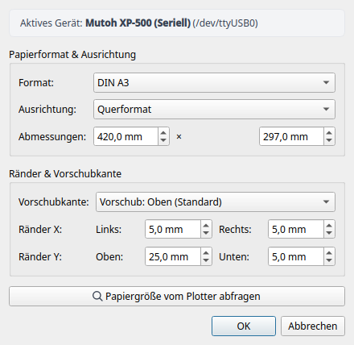
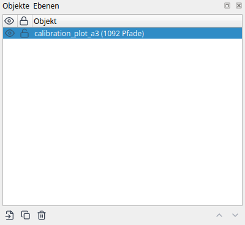
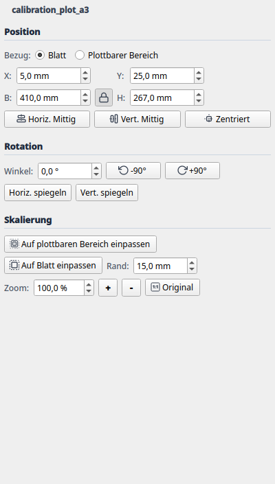

# 2. Layout-Modus & Objektverwaltung

Der **Layout-Modus** ist die kreative Schaltzentrale von LINTO. Hier arrangierst, skalierst und drehst du deine Vektorgrafiken auf dem gewählten Papierformat, weist Stifte und Farben zu und prüfst die Abstände zu den Randbereichen des Plotters.

---

## 1. Aufbau der Benutzeroberfläche

Die Arbeitsumgebung ist übersichtlich in funktionale Bereiche unterteilt:

1. **Haupt-Canvas (Mitte):**
   * Zeigt das gewählte Papierblatt maßstabsgetreu in Millimetern an.
   * Ein **roter, gestrichelter Innenrahmen** markiert den physisch plottbaren Bereich (das sogenannte *Hard-Clip-Fenster*). Liegen Vektoren außerhalb dieses Rahmens, warnt LINTO vor möglichem Beschnitt.
   * **Lineale (oben und links):** Zeigen präzise Millimeterangaben. Der Nullpunkt (0, 0) liegt an der oberen linken Ecke des Papiers.
   * **Maus-Navigation:**
     * **Mausrad:** Zoomt stufenlos hinein und heraus (zentriert auf den Mauszeiger).
     * **Mittlere Maustaste gedrückt halten:** Verschiebt den Bildausschnitt (Pan).
     * **Linke Maustaste:** Selektiert Objekte und ermöglicht direktes Verschieben per Drag & Drop.

2. **Werkzeug- & Geräteleiste (oben):**
   * Modus-Umschaltung zwischen **Layout-Modus** und **Ausgabe-Modus** (Plot-Vorschau).
   * Datei-Aktionen: **Öffnen** (`Strg+O`), **Speichern** (`Strg+S`), **Importieren** (`Strg+I`).
   * Ansichtssteuerung: **Blatt im Fenster einpassen** (`Strg+0`), **Hineinzoomen** (`+`), **Herauszoomen** (`-`).
   * Bearbeitung & Anordnung: Rückgängig (`Strg+Z`), Wiederholen (`Strg+Y`), Duplizieren (`Strg+D`), Löschen (`Entf`), Drehen (90° links/rechts), Mittig ausrichten, Auf Auswahl zoomen, 1:1 Originalgröße.
   * Schnelltaste für die **Seiteneinrichtung** (zeigt das aktive Format, z. B. `DIN A3 Quer`).
   * Schnellauswahl des aktiven Plotters (z. B. *Mutoh XP-500 (Seriell)*) und Schnelltaste für **Geräte-Einstellungen**.

3. **Rechte Werkzeug-Docks:**
   * **Dock "Objekte & Ebenen":** Baumansicht aller geladenen Dokumente, Gruppen und Pfade.
   * **Dock "Transformation":** Numerische Steuerung für Position (Bezug Blatt/Plottbereich), Drehung, Ausrichtung und Skalierung (Zoom, Original, Einpassen).
   * **Dock "Stifte & Farben":** Verwaltung der Stiftpalette und Zuordnung der Zeichenwerkzeuge.
   *(Tipp: Wenn Docks als Tabs gruppiert sind, dient der Tab-Reiter direkt als platzsparende Titelleiste.)*

---

## 2. Blatt- & Seiteneinrichtung

Vor dem Platzieren von Grafiken solltest du das gewünschte Blattformat und Randprofil festlegen. Klicke in der Werkzeugleiste auf **[ Seiteneinrichtung... ]**.

### Einstellungsoptionen im Dialog:
* **Standard-Formate:** Schnellauswahl aus DIN A4, A3, A2, A1 und A0.
* **Benutzerdefiniert:** Freie Eingabe von Breite und Höhe in Millimetern (z.B. für Sonderformate oder Zuschnitte von der Papierrolle).
* **Ausrichtung:** Umschaltung zwischen **Hochformat (Portrait)** und **Querformat (Landscape)**.
* **Randprofil (Margin Profile):**
  * *EXP (Expanded):* Minimale Ränder für maximale Zeichenfläche (Standard beim Mutoh XP-500: 25 mm Einzug, 5 mm an den anderen drei Seiten).
  * *NORM (Normal):* Größere Sicherheitsabstände (35 mm / 15 mm).
  * *TYPE1 / TYPE3:* Spezialprofile für Rollenpapier.
  * *default / minimal:* Symmetrische Ränder für Flachbettplotter und Schneideplotter.
* **Plotter abfragen (Live-Hard-Clip):**
  Ist ein Plotter per RS-232 oder Netzwerk verbunden, fragt dieser Button über den HP-GL-Befehl `OH;` die exakten Grenzen des aktuell eingespannten Papiers direkt von den optischen Sensoren der Hardware ab. Format und Maße werden automatisch übernommen.

---

## 3. Vektorgrafiken importieren

LINTO unterstützt zwei direkt importierbare Vektorformate:
* **SVG (`.svg`):** Das empfohlene Hauptformat für Vektorgrafiken aus Inkscape, eigenen Skripten (Python, Processing, p5.js), Blender, Adobe Illustrator, Affinity Designer oder CAD-Exporten. Mathematische Kurven (Bézier-Kurven, Kreisbögen) bleiben beim Import verlustfrei erhalten und werden erst bei der Plot-Aufbereitung nach eingestellter Toleranz linearisiert.
* **HP-GL (`.hpgl`, `.plt`):** Direkter Import bestehender Plotter-Dateien (inklusive Stiftwahl `SP1`–`SP8`, Kreisen `CI`, Bögen `AA`/`AR`, Rechtecken `EA`/`RA` sowie `LB`-Textbeschriftungen über den integrierten 5×7-Vektorzeichensatz).

### Import-Möglichkeiten:
1. **Drag & Drop:** Ziehe eine oder mehrere `.svg`-, `.hpgl`- oder `.plt`-Dateien direkt aus dem Dateimanager in das Canvas-Fenster.
2. **Datei öffnen (`Strg+O`):** Öffnet ein bestehendes LINTO-Projekt oder eine Vektordatei direkt als neues Dokument. Entsprechen die Abmessungen einer SVG-Datei keinem Standard-DIN-Format (z. B. 10×10 cm), wird das Blattformat automatisch als passendes benutzerdefiniertes Format eingerichtet.
3. **Importieren (`Strg+I`):** Lädt weitere Vektorgrafiken als zusätzliche Objekte in das bereits geöffnete Layout hinzu.

### Automatisches Farb-Clustering (SVG) & Stiftübernahme (HP-GL)
* **SVG:** Beim Import analysiert LINTO alle Strichfarben (`stroke`) in der Datei und ordnet sie über einen wahrnehmungsgerechten Farbabstands-Algorithmus (Delta-E im CIE-Lab-Farbraum) automatisch den 8 Stiften der Palette zu.
* **HP-GL / PLT:** Die in der Plotdatei enthaltenen `SP1;`–`SP8;`-Befehle werden direkt den Stiften 1–8 in LINTO zugewiesen.

---

## 4. Dock "Objekte & Ebenen" (Z-Order)

Das Dock **Objekte & Ebenen** listet alle geladenen Zeichnungselemente hierarchisch auf.

### Funktionen und Bedienelemente:
* **Sichtbarkeit (Auge-Symbol):** Schaltet ein Objekt oder eine Ebene unsichtbar. Unsichtbare Objekte werden weder im Canvas gerendert noch an den Plotter gesendet.
* **Sperren (Schloss-Symbol):** Schützt das Objekt vor versehentlichem Verschieben, Transformieren oder Löschen im Canvas.
* **Z-Reihenfolge (Zeichenabfolge):**
  * Objekte, die in der Liste weiter oben stehen, werden im Canvas über den darunter liegenden Objekten dargestellt.
  * Über die Schaltflächen **[ Nach oben ]** und **[ Nach unten ]** kannst du die Reihenfolge ändern.
  * *Praxistipp:* Bestimme so, welche Objekte zuerst oder zuletzt gezeichnet werden.
* **Verwaltung:**
  * **Doppelklick auf Namen:** Benennt das Objekt direkt um.
  * **[ Duplizieren ] (`Strg+D`):** Erstellt eine leicht versetzte Kopie des ausgewählten Objekts.
  * **[ Löschen ] (`Entf`):** Entfernt das Objekt aus dem Dokument (vollständig über `Strg+Z` rückgängig machbar).

---

## 5. Dock "Transformation"

Das Dock **Transformation** erlaubt die millimetergenaue Positionierung, Drehung, Ausrichtung und Skalierung eines oder mehrerer ausgewählter Objekte. Wenn Docks als Reiter (Tabs) gruppiert sind, wird die interne Titelleiste automatisch ausgeblendet und der Tab-Reiter dient als platzsparende Beschriftung.

### 1. Gruppe "Position":
* **Bezug:** Auswahl zwischen **Blatt** (gesamtes Papierformat) und **Plottbarer Bereich** (physisches Hard-Clip-Fenster des Plotters). Alle Koordinaten und Ausrichtungen orientieren sich an diesem gewählten Rahmen.
* **X / Y (mm):** Exakte Position der oberen linken Ecke des ausgewählten Objekts.
* **B / H (mm):** Exakte Breite und Höhe des Objekts in Millimetern.
* **Proportions-Sperre (Schloss-Symbol):**
  * *Aktiviert (geschlossen):* Änderungen an Breite oder Höhe passen die jeweils andere Achse proportional an.
  * *Deaktiviert (geöffnet):* Erlaubt unproportionales Skalieren / Verzerren.
* **[ Horiz. Mittig ]:** Zentriert die Auswahl horizontal auf dem gewählten Bezugsrahmen (Blatt oder plottbarer Bereich).
* **[ Vert. Mittig ]:** Zentriert die Auswahl vertikal auf dem gewählten Bezugsrahmen.
* **[ Zentriert ] (Fadenkreuz):** Setzt die Auswahl exakt in die geometrische Mitte des Bezugsrahmens.

### 2. Gruppe "Rotation":
* **Winkel (`°`):** Dreht alle ausgewählten Objekte um einen beliebigen Winkel (`-360,0°` bis `+360,0°`).
* **[ -90° ] / [ +90° ]:** Schnelle Drehung der Auswahl um 90 Grad gegen den bzw. im Uhrzeigersinn.
* **[ Horiz. spiegeln ] / [ Vert. spiegeln ]:** Spiegelt die ausgewählten Objekte horizontal bzw. vertikal an ihrem Mittelpunkt.

### 3. Gruppe "Skalierung":
* **[ Auf plottbaren Bereich einpassen ]:** Skaliert die Auswahl proportional so groß wie möglich in den physisch plottbaren Bereich.
* **[ Auf Blatt einpassen ] & Rand (mm):** Skaliert die Auswahl proportional auf das Papierblatt unter Berücksichtigung des einstellbaren Sicherheitsabstands (`Rand`).
* **Zoom (%):** Stufenlose numerische Skalierung in Prozent (100,0 % = Originalgröße).
* **[ + ] / [ - ]:** Schnelles Vergrößern bzw. Verkleinern in 10 %-Schritten (+10 % / -10 %).
* **[ Original ]:** Setzt die Abmessungen des Objekts sofort auf die 1:1 Originalgröße (100 %) der Quelldatei zurück.

---

## 6. Stiftpalette & Farbzuweisung

Im Dock **Stifte & Farben** verwaltest du die 8 logischen Stiftkanäle des Plotters (inklusive Strichstärke, Zeichengeschwindigkeit `VS` in `cm/s` und Anpressdruck `FS` in `g`):

| Stift | Standardfarbe | Hex-Code | Empfohlene Verwendung |
|---|---|---|---|
| **Stift 1** | Schwarz | `#000000` | Hauptkonturen, Beschriftung |
| **Stift 2** | Rot | `#d32f2f` | Hervorhebungen, Bemaßung |
| **Stift 3** | Blau | `#1976d2` | Hilfslinien, Schraffuren |
| **Stift 4** | Grün | `#388e3c` | Sekundäre Geometrie |
| **Stift 5** | Orange | `#f57c00` | Flächenschraffur |
| **Stift 6** | Magenta | `#7b1fa2` | Feine Details |
| **Stift 7** | Cyan | `#0097a7` | Entwürfe |
| **Stift 8** | Gelb | `#fbc02d` | Marker / Akzente |

Durch Rechtsklick auf ein Objekt im Canvas oder Auswahl im Stifte-Dock kannst du jedem Objekt jederzeit eine andere Stiftnummer zuweisen.

---

> [!TIP]
> Ausführliche Anleitungen zur optimalen Vorbereitung eigener SVG-Skripte (Maßeinheiten, Farbcodes für Stifte), dem Einsatz von Inkscape und Blender als Vektorgeneratoren sowie Tipps zu HP-GL und DXF findest du im eigenständigen **[Kapitel 6: Leitfaden: Vektorformate, Quellen & Workflows](6-vektorformate-und-workflows.md)**.
> 
> Eine kuratierte Sammlung empfohlener Community-Tools (Awesome Plotters, Drawingbots, Inkcut, vpype, vsketch) bietet **[Kapitel 8: Empfohlene Ressourcen, Tools & Community-Sammlungen](8-ressourcen-tools-und-community.md)**.

