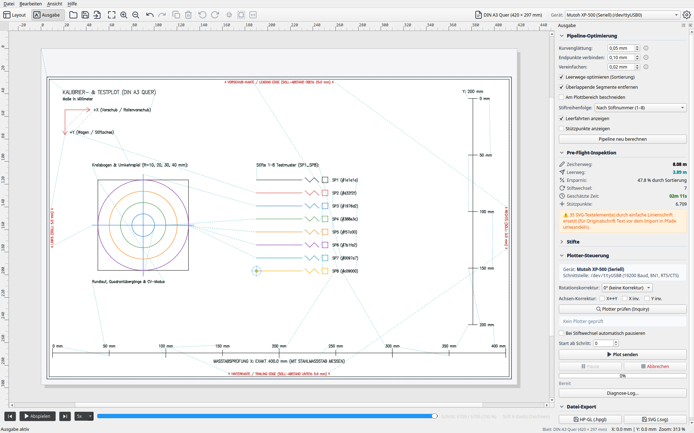

# 3. Ausgabe-Modus, Simulation & Export

Im **Ausgabe-Modus** (Plot-Modus) wird die Zeichnung für die physikalische Hardware aufbereitet. Du siehst die optimierten Werkzeugwege inklusive aller Stift-Leerfahrten, kannst den Plot mit einer Zeitleiste simulieren, Statistiken zur Zeitersparnis prüfen und den Plot direkt an das Gerät senden oder als Datei exportieren.



---

## 1. Die Optimierungs-Pipeline (Tuning)

Im oberen Bereich des Docks **Ausgabe** konfigurierst du die Algorithmen, die aus Rohvektoren effiziente Maschinenbewegungen machen (per Klick auf den Pfeil bzw. die Überschrift ein- und ausklappbar, standardmäßig für eine kompakte Ansicht eingeklappt):


* **Linien zusammenfassen (Merge):**
  Sucht nach offenen Pfadenden, die nahe beieinander liegen, und verbindet sie zu durchgehenden Polylinien.
  * *Toleranz-Schieberegler (mm):* Bestimmt den maximalen Abstand zweier Punkte, die als zusammenhängend gelten (Standard: 0,1 mm).
  * *Effekt:* Verhindert unnötiges Abheben und Aufsetzen des Stifts; Linien werden flüssig durchgezogen.
* **Pfade umkehren (Reverse):**
  Erlaubt der Pipeline, die Zeichenrichtung einer Linie umzukehren, falls das Ende des vorherigen Pfads näher am Endpunkt als am Anfangspunkt des nächsten Pfads liegt.
* **RDP-Vereinfachung (Douglas-Peucker):**
  Reduziert redundante Stützpunkte auf geraden oder gleichmäßig gekrümmten Linien.
  * *Toleranz-Schieberegler (mm):* Typischerweise 0,05 bis 0,1 mm.
  * *Effekt:* Deutlich schlankere Datenströme, weniger Belastung für den Plotter-Prozessor und ruhigere Motorbewegungen ohne Ruckeln.
* **Pfadoptimierung (2-Opt TSP):**
  Löst das *Problem des Handlungsreisenden* für die Stiftbewegungen. Die Reihenfolge aller Linien wird mathematisch so permutiert, dass die Distanz der Leerfahrten mit angehobenem Stift auf ein Minimum schrumpft.
* **[ Pipeline anwenden ]:**
  Berechnet alle Optimierungen neu und aktualisiert die Vorschau im Canvas sowie die Pre-Flight-Statistiken.

---

## 2. Pre-Flight-Inspektion & Statistiken

Vor jedem Plot liefert die Pre-Flight-Analyse genaue Kennzahlen über den Auftrag:

| Kennzahl | Typischer Wert | Bedeutung |
|---|---|---|
| **Gezeichneter Weg** | `12,85 m` | Tatsächliche Strecke, die der Stift mit Kontakt zum Papier zurücklegt (`Pen Down`). |
| **Eilgang (Leerfahrten)** | `3,42 m` | Fahrstrecke des Plotterkopfs mit angehobenem Stift (`Pen Up`). |
| **Eilgang-Ersparnis** | `+54,2 %` | Zeit- und Wegersparnis gegenüber unoptimierten SVG-Rohdaten durch 2-Opt. |
| **Stiftwechsel** | `4` | Anzahl der Werkzeugwechsel im Karussell. |
| **Geschätzte Dauer** | `3m 45s` | Voraussichtliche Laufzeit auf Basis der Plotter-Geschwindigkeitsparameter. |

---

## 3. Die Simulation mit dem Scrubber

Unterhalb des Haupt-Canvas befindet sich die interaktive **Simulationsleiste**:

```
[ Play ]  [ Einzel zurück ]  [ Einzel vor ]  ===●====================== 35 %   [ 5x ]
```

### Canvas-Visualisierung im Ausgabe-Modus:
* **Farbige Linien:** Zeichnen die tatsächlichen Striche in den zugewiesenen Stiftfarben nach.
* **Türkis / Cyan gestrichelte Linien:** Stellen die **Eilgang-Leerfahrten** (`Pen Up`) dar. So erkennst du auf einen Blick, wie der Kopf zwischen den Elementen springt.
* **Gelbe / Orange Markierungen:** Heben die Aufsetz- und Abhebepunkte hervor.
* **Toolhead-Cursor (Fadenkreuz):** Zeigt die exakte Position des Stifts zum aktuellen Zeitschritt.

### Steuerungsfunktionen:
* **Schieberegler (Scrubber):** Ziehe den Regler mit der Maus, um den gesamten Plotprozess in beliebiger Geschwindigkeit vor- oder zurückzuspulen.
* **[ Play ] / [ Pause ]:** Startet oder stoppt eine flüssige Animation des Plotvorgangs.
* **Geschwindigkeitsauswahl:** Umschaltbar zwischen **1x**, **2x**, **5x** und **10x** Abspielgeschwindigkeit.
* **Schrittweises Vor-/Zurückspringen:** Prüfe kritische Stellen Vektor für Vektor.

---

## 4. Selektives Plotten (Stifte)

In der Sektion **Stifte** des Ausgabe-Docks verfügt jeder Stift über eine eigene Checkbox:

* **Stift aktivieren / deaktivieren:**
  * Ist das Häkchen entfernt, werden alle Linien dieses Stifts aus dem aktuellen Plot-Auftrag ausgeschlossen.
* **Typische Anwendungsfälle:**
  * **Manueller Stiftwechsel:** Besitzt dein Plotter nur einen einzigen Stifthalter, deaktiviere alle Stifte bis auf Stift 1. Nach dem Plotten wechselst du den Stift physisch, aktivierst Stift 2 und plottest die nächste Farbe.
  * **Testplots & Probedrucke:** Teste z.B. nur die Rahmenlinien oder eine feine Schraffur, bevor der gesamte mehrfarbige Plot gestartet wird.

---

## 5. Live-Plotten auf der Hardware

Die Sektion **Plotter-Verbindung & Ausgabe** steuert den physikalischen Datentransfer:

### Schritt 1: Verbindung & Hardware-Inquiry
1. Wähle den gewünschten Anschluss (z.B. `/dev/ttyUSB0` unter Linux oder `COM3` unter Windows bzw. `tcp://...`).
2. Klicke auf **[ Plotter prüfen (Inquiry) ]**.
3. Plotter Studio sendet `OI;` (Modellabfrage) und `OH;` (Hard-Clip-Abfrage) an das Gerät.
4. Bei erfolgreicher Rückmeldung leuchtet das Banner grün auf:
   `7585B (A3, 40 U/mm) • Hard-Clip: 390x287 mm`.

### Schritt 2: Plot starten
* Klicke auf **[ Plot senden ]**.
* Der Auftrag wird im Hintergrund über den `SerialStreamer` gestreamt.
* Ein Fortschrittsbalken zeigt den Prozentsatz gesendeter Befehle an.
* Im Canvas wandert der Toolhead-Cursor synchron mit dem realen Plotterkopf über das virtuelle Blatt.

### Schritt 3: Pausieren oder Notfall-Abbruch
* **[ Pause ] / [ Fortsetzen ]:** Hält die Befehlsübertragung sofort an (z.B. um Tinte zu kontrollieren oder Papier nachzujustieren) und setzt sie nahtlos fort.
* **[ Abbrechen ]:** Löst den Notfall-Rückzug aus:
  1. Sendet sofort `\x1b.K` (Clear Buffer) zum Leeren des Plotter-Puffers.
  2. Hebt den Stift an (`PU;`).
  3. Legt den Stift sicher im Halter ab (`SP0;`).

---

## 6. Datei-Export

Möchtest du den optimierten Plot für später archivieren oder auf einem separaten Steuerungsrechner ausführen:

* **[ Plotdatei (.hpgl) exportieren... ]:**
  Erzeugt eine saubere, standardkonforme HP-GL/PLT-Datei. Alle Koordinaten sind exakt auf das Zielgerät, den Nullpunkt und die Stiftwechsel abgestimmt.
* **[ Plot-Vektoren (.svg) exportieren... ]:**
  Exportiert das Ergebnis der Optimierung als SVG-Vektordatei. Die Pfade sind sauber nach Stiftfarben in SVG-Gruppen (`<g id="pen_1">` etc.) strukturiert.

