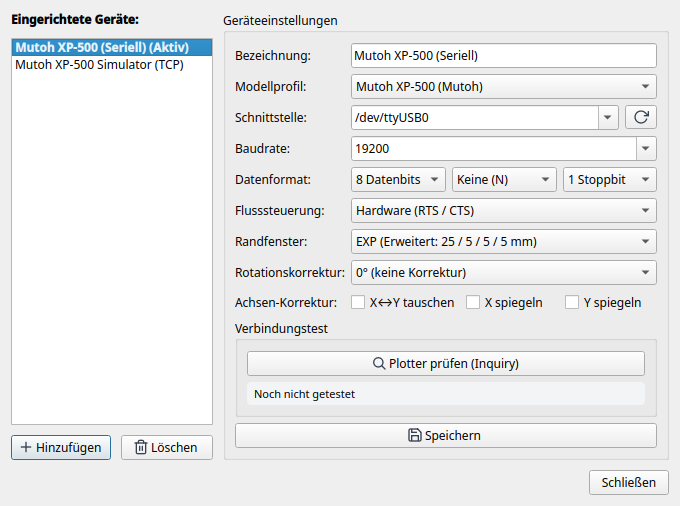

# 4. Hardware-Setup, Kalibrierung & Diagnose

Hier erfährst du, wie du deinen Stiftplotter physikalisch mit dem Computer verbindest, die Schnittstellenparameter am Gerät und im Dialog *Geräte-Einstellungen* konfigurierst, die Verbindung mit dem integrierten Diagnosetool testest und den offiziellen Kalibrierplot durchführst.

---

## 1. Physischer Anschluss & Verkabelung

Klassische Plotter nutzen serielle RS-232-Schnittstellen (meist 25-polige DB-25-Buchsen oder 9-polige DB-9-Buchsen). Moderne Computer verfügen in der Regel über keine nativen COM-Ports mehr, weshalb ein USB-zu-Seriell-Adapter verwendet wird.

### Empfohlene USB-Seriell-Adapter
* **Chipsatz:** Verwende Adapter mit Original-Chipsätzen von **FTDI** (z.B. FT232R, FT2232) oder **Silicon Labs** (CP2102).
* **Vorsicht:** Billige Nachbauten ohne echten RTS/CTS-Hardware-Handshake führen bei größeren Vektordaten unweigerlich zu Pufferüberläufen und Datenverlust.

### Nullmodem-Verkabelung mit echtem Hardware-Handshake
Für eine zuverlässige Kommunikation ist ein vollbeschaltetes Nullmodem-Kabel (Cross-Over) zwingend erforderlich:

| Signal | PC-Seite (DB-9 Buchse) | Plotter-Seite (DB-25 Stecker) | Plotter-Seite (DB-9 Stecker) | Beschreibung |
|---|---|---|---|---|
| **RxD** (Empfang) | Pin 2 | Pin 2 (TxD) | Pin 3 (TxD) | Empfangsdatenleitung |
| **TxD** (Senden) | Pin 3 | Pin 3 (RxD) | Pin 2 (RxD) | Sendedatenleitung |
| **GND** (Masse) | Pin 5 | Pin 7 (GND) | Pin 5 (GND) | Signalmasse |
| **RTS** (Request to Send) | Pin 7 | Pin 5 (CTS) | Pin 8 (CTS) | PC signalisiert Empfangsbereitschaft |
| **CTS** (Clear to Send) | Pin 8 | Pin 4 (RTS) | Pin 7 (RTS) | **Plotter steuert Datenfluss (Handshake)** |
| **DTR** (Data Terminal Ready)| Pin 4 | Pin 6 (DSR) | Pin 6 (DSR) | Betriebsbereitschaft |
| **DSR** (Data Set Ready) | Pin 6 | Pin 20 (DTR) | Pin 4 (DTR) | Betriebsbereitschaft |

> **Wichtig:** Eine einfache 3-Draht-Verbindung (nur TxD, RxD, GND) ohne RTS/CTS funktioniert bei Stiftplottern nicht sicher, da der Plotter bei komplexen Kurvenfahrten den PC anhalten können muss.

### Alternative: TCP / Ethernet Device Server
Statt eines USB-Kabels kannst du auch Serial-to-Ethernet-Boxen (z.B. Moxa NPort, USR-TCP232) oder einen Raspberry Pi mit `socat` verwenden. LINTO unterstützt TCP-Sockets nativ über die Portangabe `tcp://<IP-Adresse>:<Port>` (z.B. `tcp://192.168.1.150:4001`).

---

## 2. Bedienfeld- und Panel-Setup (Beispiel Mutoh XP-500)

Stelle am Bedienfeld oder den DIP-Schaltern des Plotters folgende Parameter ein:

* **Emulation:** HP-7585B oder MH-GL.
* **Baudrate:** `19200` Baud (oder `9600` Baud bei langen Kabelwegen).
* **Datenformat:** `8` Datenbits, `keine` Parität (None), `1` Stoppbit (**8N1**).
* **Handshake / Flow Control:** **Hardware (RTS/CTS)**. *XON/XOFF muss deaktiviert sein*.
* **Randmodus (Margin Profile):** **EXP** (Expanded).
* **Papiereinzug:** Nach dem Einlegen des Papiers liest der optische Sensor die Ränder automatisch ein.

---

## 3. Dialog „Geräte-Einstellungen“

Öffne über die obere Werkzeugleiste oder das Menü **Geräte → Einstellungen...** den Konfigurationsdialog, um deinen Plotter in LINTO einzurichten:



* **Plotter-Liste:** Zeigt alle angelegten Gerätekonfigurationen an.
* **[ Neues Gerät ]:** Legt eine neue Gerätekonfiguration an.
* **Einstellungen pro Gerät:**
  * **Anzeigename:** Frei wählbarer Name (z.B. `Mutoh XP-500 Studio` oder `Roland DXY-1150 Flachbett`).
  * **Geräteprofil:** Auswahl des Hardware-Grundmodells aus den über 25 mitgelieferten Profilen (z.B. `mutoh_xp500`, `roland_dxy`, `hpgl_generic`).
  * **Schnittstelle & Baudrate:** Serieller Port (z.B. `/dev/ttyUSB0`) oder Netzwerkadresse (`tcp://127.0.0.1:9999`) sowie Baudrate, Parität und Flusssteuerung.
  * **Randprofil:** Gewünschtes Standard-Margin-Profil des Geräts.

> [!NOTE]
> Wie du weitere Plottermodelle einbindest, eigene YAML-Geräteprofile erstellst oder Profile aus Inkcut importierst, erfährst du in **[Kapitel 5: Anbindung weiterer Plottermodelle & Geräteprofile](5-plottermodelle-und-geraeteprofile.md)**.

---

## 4. Hardware-Diagnose mit `tools/xp500_probe.py`

LINTO liefert ein eigenständiges Terminal-Diagnosewerkzeug mit, mit dem du die Schnittstelle und alle Rückmeldungen auf Bit- und Byte-Ebene prüfen kannst:

```bash
# Aufruf über USB-Seriell:
python3 tools/xp500_probe.py /dev/ttyUSB0

# Aufruf mit Baudrate und detaillierten ESC-Sequenzen:
python3 tools/xp500_probe.py /dev/ttyUSB0 --baudrate 19200 --esc

# Aufruf über Netzwerk / TCP-Server:
python3 tools/xp500_probe.py tcp://127.0.0.1:9999
```

### Typische Ausgabe bei fehlerfreier Verbindung:
```text
=================================================================
  LINTO – Mutoh XP-500 Hardware-Diagnose (AP0)
=================================================================
Ziel:      /dev/ttyS5
Baudrate:  19200
Timeout:   0.6 s
-----------------------------------------------------------------
Verbindung: Serieller Port geöffnet. Signals: CTS=True, DSR=True

Abfrage-Ergebnisse (siehe docs/devices/mutoh-xp500/testplan.md):
-----------------------------------------------------------------
OI;      | Modell-Identifikation (Standard) | 7585B
OF;      | Zeicheneinheit (Units/mm)      | 40,40
OH;      | Plottbereich / Hard-Clip       | -3678,-5692,3679,5692
OS;      | Statusbyte                     | 26
OE;      | Fehlerstatus (HP-GL)           | 0
OA;      | Aktuelle Position & Stift      | -3077,-5092,0
OT;      | Stiftkarussell-Status          | 1,0
OO;      | Optionen                       | 0,1,0,0,1,1,0,1
ESC.A    | ESC.A (Erweiterte ID)          | 7585B
ESC.L    | ESC.L (Puffergröße)            | 1024
ESC.B    | ESC.B (Freier Puffer)          | 1024
ESC.O    | ESC.O (Erweiterter Status)     | 392
ESC.E    | ESC.E (Erweiterter Fehler)     | 0
-----------------------------------------------------------------

Auswertung:
• Modell:        7585B
• Auflösung:     40.0 Units/mm (Schrittweite: 0.0250 mm)
• Hard-Clip:     X: [-3678, 3679], Y: [-5692, 5692] Units
• Abmessungen:   183.9 × 284.6 mm (Plottbarer Bereich)
• Erkanntes Blatt: DIN A4
• Puffer:        Gesamt: 1024 Bytes, Frei: 1024 Bytes
=================================================================
```

Erscheint hier ein Timeout oder `CTS=False`, überprüfe das Nullmodem-Kabel, die Einstellungen am Plotterbedienfeld (Protokoll/Handshake) sowie die nachfolgenden Hinweise zur Betriebssystem-Einrichtung.

---

## 5. Betriebssystem-Einrichtung & Fehlerbehebung (RS-232)

### Linux

Unter Linux werden serielle Schnittstellen als Gerätedateien unter `/dev/` abgebildet. Je nach verwendeter Hardware gibt es einige typische Hürden bei Berechtigungen, Hintergrunddiensten oder Interrupts.

#### 1. Den richtigen Portnamen finden (`/dev/ttyUSB*` vs. `/dev/ttyS*`)
* **USB-zu-Seriell-Adapter** (FTDI, Silicon Labs CP210x, Prolific PL2303, CH340) erscheinen als `/dev/ttyUSB0`, `/dev/ttyUSB1` usw. (seltener als `/dev/ttyACM0`).
* **Onboard-RS-232 & gesteckte PCIe-Schnittstellenkarten** (16550A-kompatible UARTs) werden als `/dev/ttyS0`, `/dev/ttyS1` usw. angelegt. Da die Kernel-Treiber oft `/dev/ttyS0` bis `/dev/ttyS3` für Mainboard-Anschlüsse reservieren, erhalten gesteckte PCIe-Karten häufig höhere Nummern wie `/dev/ttyS4` und `/dev/ttyS5`.

Mit `dmesg` lässt sich direkt prüfen, welche Schnittstellen der Kernel beim Starten oder Einstecken erkannt hat:
```bash
sudo dmesg | grep -E "ttyS|ttyUSB|ttyACM"
```
Beispielausgabe bei einem Mainboard-Port (`ttyS0`) und einer 2-Port PCIe-Karte (`ttyS4`, `ttyS5`):
```text
[    0.702046] serial8250: ttyS0 at I/O 0x3f8 (irq = 4, base_baud = 115200) is a 16550A
[    0.704314] 0000:04:00.0: ttyS4 at I/O 0xe010 (irq = 41, base_baud = 115200) is a 16550A
[    0.704696] 0000:04:00.1: ttyS5 at I/O 0xe000 (irq = 42, base_baud = 115200) is a 16550A
```

#### 2. Fehlende Berechtigung (`Errno 13: Keine Berechtigung`)
Standardmäßig darf ein normaler Benutzer unter Linux nicht direkt auf `/dev/ttyS*` oder `/dev/ttyUSB*` zugreifen. Die Gerätedateien gehören der Systemgruppe `dialout` (Debian, Ubuntu, Linux Mint, Fedora, openSUSE) bzw. `uucp` (Arch Linux, Manjaro).

1. **Prüfen, welcher Gruppe der Port gehört:**
   ```bash
   ls -l /dev/ttyS5
   # Beispiel: crw-rw----. 1 root dialout 4, 69 19. Okt 15:40 /dev/ttyS5
   ```
2. **Eigenen Benutzer dauerhaft zur Gruppe `dialout` hinzufügen:**
   ```bash
   sudo usermod -aG dialout $USER
   ```
   > [!IMPORTANT]
   > Gruppenänderungen unter Linux werden erst wirksam, wenn du dich **einmal komplett von der grafischen Desktop-Sitzung abmeldest und wieder anmeldest** (oder den Rechner neu startest).

3. **Sofort-Workaround ohne Abmelden (für die laufende Sitzung):**
   Wenn du dich gerade nicht abmelden möchtest, kannst du die Berechtigung für den Port temporär bis zum nächsten Neustart direkt freischalten:
   ```bash
   sudo setfacl -m u:$USER:rw /dev/ttyS5
   ```

#### 3. PCIe-Schnittstellenkarten & Interrupt-Probleme (`No irq handler` / Timeout)
Beim Einsatz nachgerüsteter PCIe-RS-232-Karten (z. B. mit dem verbreiteten **ASIX AX99100** Chip `[125b:9100]`, MosChip MCS99xx oder WCH CH382) kann es unter Linux vorkommen, dass der generische Kernel-Treiber (`8250_pci`) zwar die Ports `/dev/ttyS4` / `/dev/ttyS5` anlegt und die Statusleitungen (`CTS=True`, `DSR=True`) korrekt liest, aber jegliche Datenübertragung in einen **Timeout** läuft.

* **Typisches Symptom:** Im Systemlog (`journalctl -kf` oder `dmesg`) erscheint beim Zugriffversuch eine Kernel-Meldung wie:
  ```text
  kernel: No irq handler for 13.32
  ```
* **Ursache:** Das Hardware-Interrupt-Routing (MSI/APIC) zwischen der PCIe-Karte und dem `8250_pci`-Treiber schlägt fehl. Der UART-Chip empfängt zwar die Antwort vom Plotter im Hardware-Puffer, kann die CPU aber nicht per Interrupt benachrichtigen.
* **Workaround (`setserial` Polling-Modus):**
  Setzt man den IRQ des seriellen Ports mit dem Werkzeug `setserial` auf `0`, verzichtet der Linux-Kernel auf Hardware-Interrupts und fragt den Port stattdessen zuverlässig per **Timer-Polling** ab:
  ```bash
  # setserial installieren (falls noch nicht vorhanden):
  sudo dnf install setserial   # Fedora / RHEL
  sudo apt install setserial   # Debian / Ubuntu

  # Port auf Polling-Modus (IRQ 0) umschalten:
  sudo setserial /dev/ttyS5 irq 0

  # Einstellung überprüfen:
  setserial -a /dev/ttyS5
  ```
* **Dauerhaft über Neustarts hinweg speichern (udev-Regel):**
  Da die `setserial`-Einstellung beim Neustart verloren geht, lässt sie sich über eine udev-Regel in `/etc/udev/rules.d/99-serial-polling.rules` automatisieren:
  ```udev
  ACTION=="add", SUBSYSTEM=="tty", KERNEL=="ttyS4", RUN+="/bin/setserial /dev/%k irq 0"
  ACTION=="add", SUBSYSTEM=="tty", KERNEL=="ttyS5", RUN+="/bin/setserial /dev/%k irq 0"
  ```

#### 4. Typische Störquellen bei USB-Seriell-Adaptern (`brltty` & `ModemManager`)
* **`brltty` kapert den USB-Adapter:** Auf vielen Distributionen (Ubuntu, Debian, Fedora) ist standardmäßig der Dienst `brltty` für Sehbehinderten-Braillezeilen aktiv. Dessen udev-Regeln halten manche USB-Seriell-Adapter (insbesondere FTDI und CH340) fälschlicherweise für eine Braillezeile und entziehen dem System Sekunden nach dem Einstecken sofort wieder das Gerät `/dev/ttyUSB0` (`dmesg` meldet `interface 0 claimed by ftdi_sio while 'brltty' sets config #1` / `ttyUSB0: now disconnected`).
  * *Abhilfe (wenn keine Braillezeile genutzt wird):* Dienst deaktivieren oder Paket `brltty` deinstallieren:
    ```bash
    sudo systemctl stop brltty.path brltty.service
    sudo systemctl mask brltty.path brltty.service
    ```
* **`ModemManager` sendet beim Einstecken `AT`-Befehle:** Direkt nach dem Einstecken eines USB-Seriell-Adapters prüft `ModemManager` den Port für einige Sekunden auf ein vermeintliches Mobilfunkmodem. Warte nach dem Einstecken ca. 5–10 Sekunden, oder schalte den Plotter erst ein, nachdem der USB-Adapter verbunden wurde, damit die `AT`-Zeichen keinen HP-GL-Syntaxfehler am Plotter auslösen.

#### 5. Manueller Schnelltest über die Linux-Konsole (`stty` & `cat`)
Um völlig unabhängig von Python oder LINTO zu testen, ob Schnittstelle, Kabel und Plotter auf Betriebssystemebene kommunizieren, kann der Port auch direkt mit Bordmitteln konfiguriert und beschrieben werden (`19200` Baud, `8N1`, Hardware-Handshake `crtscts`):

```bash
stty -F /dev/ttyS5 19200 -parenb cs8 -cstopb crtscts
cat Hello-World.hpgl > /dev/ttyS5
```

---

### macOS

* **Gerätenamen:** USB-Seriell-Adapter erscheinen unter macOS im Verzeichnis `/dev/` jeweils doppelt – als `/dev/tty.usbserial-*` und als `/dev/cu.usbserial-*`. Verwende in LINTO vorzugsweise das **`/dev/cu.*`**-Gerät (*Call-Up / Call-Out*), da `/dev/tty.*` auf ein Hardware-Carrier-Detect-Signal (DCD) wartet und sonst beim Öffnen blockieren kann.
* *(Weitere macOS-spezifische Hinweise folgen in einer späteren Version.)*

---

### Windows

* **Gerätenamen:** Unter Windows werden serielle Schnittstellen als `COM1`, `COM2`, `COM3` usw. angesprochen. Welche Nummer einem USB-Seriell-Adapter oder einer PCIe-Karte zugewiesen wurde, lässt sich im **Geräte-Manager** unter *Anschlüsse (COM & LPT)* ablesen.
* *(Weitere Windows-spezifische Hinweise folgen in einer späteren Version.)*

---

## 6. Der Kalibrierplot (Genauigkeit, Ränder, Stifte & Backlash)

Im Verzeichnis `resources/` liegen vorbereitete Kalibriermuster für DIN A4 und DIN A3 bereit:
* `resources/calibration_plot_a3.svg` / `.hpgl`
* `resources/calibration_plot_a4.svg` / `.hpgl`


### Aufbau und Prüfkriterien des Testmusters:

1. **Orientierungs-Pfeile (+X / +Y) & Kantenmarkierung:**
   * An der Einzugskante ist der Pfeil `+Y` und der Schriftzug `TOP / LEADING EDGE` aufgedruckt.
   * *Prüfung:* Wurde die Schrift kopfstehend oder gespiegelt gezeichnet? Falls ja, muss im Geräteprofil `invert_x`, `invert_y` oder `rotation_deg` angepasst werden.
2. **Präzisions-Messstrecke (400 mm bei A3 / 200 mm bei A4):**
   * Eine lange durchgezogene Messlinie mit präzisen Endstrichen.
   * *Prüfung:* Miss die gezeichnete Linie mit einem hochwertigen **Stahllineal** nach.
   * Ist die Linie z.B. exakt 400,0 mm lang, arbeitet die Schrittmotorübersetzung perfekt mit 40,0 Units/mm. Bei Abweichungen kann der Faktor im Geräteprofil (`units_per_mm`) feinjustiert werden.
3. **Äußerer Begrenzungsrahmen (Hard-Clip Check):**
   * Zeichnet ein Rechteck genau an den äußersten plottbaren Grenzen des Papiers.
   * *Prüfung:* Werden alle 4 Kanten sauber gezeichnet, ohne dass der Stift auf die Gummiwalzen läuft oder der Kopf an mechanische Begrenzer schlägt?
4. **8-Stifte-Matrix:**
   * 8 beschriftete Testboxen mit Farbstreifen.
   * *Prüfung:* Funktioniert das automatische Ein- und Auswechseln aller Stifte aus dem Karussell fehlerfrei? Schließen die Stiftkappen dicht?
5. **Konzentrische Kreise & Quadrat-in-Kreis (Umkehrspiel / Backlash):**
   * Feine konzentrische Kreise und ein exakt zentriertes Quadrat.
   * *Prüfung:*
     * Treffen die Anfangs- und Endpunkte der Kreislinien exakt aufeinander?
     * Sind Kreise kreisrund oder leicht eiförmig/elliptisch?
     * Ein Versatz an den Quadranten deutet auf mechanisches Spiel (Backlash) im Riemenantrieb oder den Andruckrollen hin.
