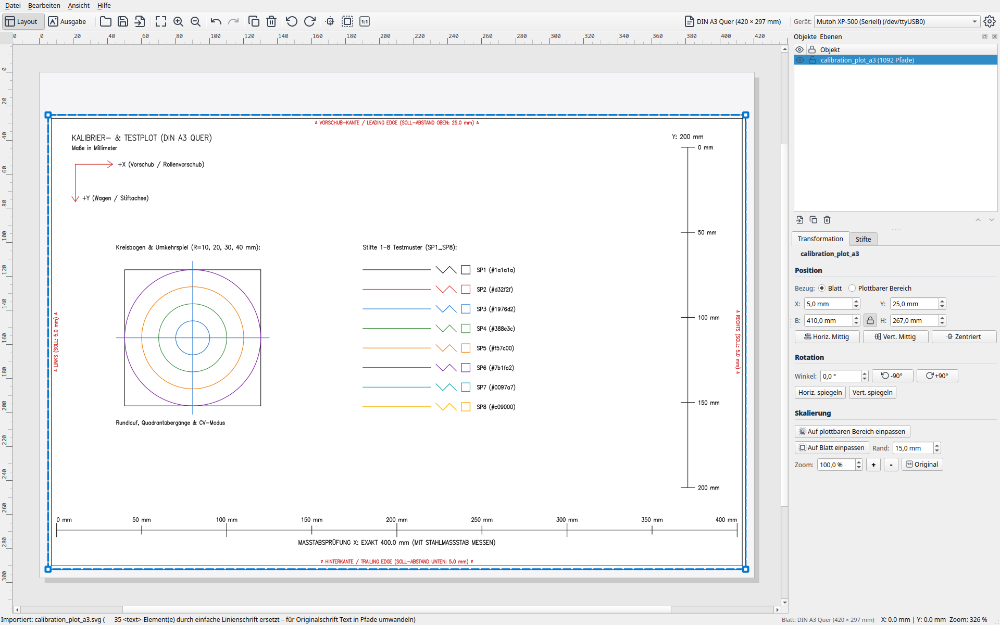

# LINTO

LINTO ist ein spezialisierter **Slicer und Arbeitsbereich für Vektor-Stiftplotter**. Es schließt die Lücke zwischen Vektor-Grafikprogrammen (wie Inkscape, Illustrator, CAD oder generativer Kunst aus Python/Processing) und der physischen Mechanik von Zeichenmaschinen.

Mit anderen Worten: Mit LINTO kann man seine Zeichnungen in richtiger Größe mit einem Stiftplotter zu Papier bringen.

LINTO wurde unter **Linux** entwickelt und getestet, sollte aber auch unter **macOS** und **Windows** laufen (ungetestet).

> [!NOTE]
> Zurzeit werden nur HP-GL-Plotter unterstützt. Die Ansteuerung anderer Plotter könnte aber integriert werden. Das interne Datenformat ist nicht an HP-GL gebunden.

---

## Was kann LINTO?
* SVG- und HP-GL/PLT-Vektordateien laden, platzieren, numerisch skalieren (50%, 100%, 200%, Proportions-Sperre), drehen (90°-Schritte oder freier Winkel) und auf dem Papier zentrieren.
* Randprofile für Rollen- und Flachbettplotter (z.B. EXP, NORM mit asymmetrischem Vorschubrand) und optische Papiererkennung (`OH;`).
* Automatisches Farb-Clustering auf bis zu 8 Stifte (SVG) bzw. direkte Übernahme der Stiftnummern `SP1`–`SP8` und `LB`-Textbeschriftungen (HP-GL).
* Multi-Objektverwaltung mit Z-Order (Zeichenabfolge), Sichtbarkeit und Bearbeitungssperre.
* Intelligente Slicer-Pipeline: Pfade verbinden (Merge), Richtung optimieren (Reverse), Mikrostützpunkte glätten (Douglas-Peucker) und 2-Opt TSP Pfadoptimierung (40–70 % weniger Stift-Leerfahrten).
* Interaktive Simulation mit Zeitleiste (Scrubber), variabler Geschwindigkeit und Visualisierung aller Leerfahrten (`Pen Up`).
* Pre-Flight-Inspektion mit genauen Werten für Zeichenstrecke, Leerweg und geschätzter Laufzeit.
* Stift-Filterung zum selektiven Plotten einzelner Farben (z.B. für manuelle Stiftwechsel).
* Live-Streaming über RS-232 oder TCP mit striktem **RTS/CTS-Hardware-Handshake** (kein Pufferüberlauf) und optionaler automatischer Pause bei Stiftwechseln.
* Sicherer Notfallabbruch (`ESC.K`, `PU;`, `SP0;`) schützt Papier und Stiftspitze.
* Offene Multi-Plotter-Architektur (Center-Origin & Bottom-Left) über YAML-Profile mit 26 Profilen: Neben Mutoh XP-500 und Generic Flatbed wurden **24 Geräteprofile direkt aus InkCut übernommen** (Roland, Graphtec, US Cutter, Summa, Sekonic etc.) sowie das Konverter-Tool `tools/import_inkcut_devices.py` bereitgestellt.
* Hardware-Diagnosetool (`tools/xp500_probe.py`), Kalibriermuster (`resources/calibration_plot_a3.svg`) und integrierter Software-Emulator (`VirtualPlotter`).

## Was kann LINTO (noch) nicht bzw. was ist geplant?
* **Schneideplotter / Schleppmesser-Kompensation (Drag-Knife Offset):** Das Schneiden von Vinylfolie mit Klingen wird noch nicht unterstützt; der Fokus liegt aktuell auf Stiftplottern.
* **Direkter DXF-Import:** Aktuell müssen CAD-Zeichnungen im DXF-Format vorab z.B. in Inkscape oder QCAD als SVG oder HP-GL exportiert werden.
* **G-Code-Plotter (Marlin / Grbl):** Die Ansteuerung von G-Code-basierten Plottern bzw. 3D-Druckern mit Stifthalter steht auf der To-do-Liste; aktuell werden nur Plotter mit HP-GL / MH-GL unterstützt.

## Was ist es gar nicht?
* **Kein Druckertreiber für Tintenstrahl-Großformatdrucker:** Großformatige Fotodrucker (z.B. HP DesignJet, Epson SureColor, Canon imagePROGRAF) werden in Büros umgangssprachlich oft als „Plotter“ bezeichnet, sind aber Pixel-Rasterdrucker. LINTO steuert ausschließlich echte **Vektor-Stiftplotter** an, die physische Stifte über Papier bewegen.
* **Keine Schneideplotter-Software (Cutter):** LINTO ist für **Stiftplotter** konzipiert. Reine Schneideplotter mit Messerklingen (Vinyl-Cutter) werden noch nicht unterstützt, da die dafür nötige Klingen-Offset-Kompensation noch fehlt (viele Cutter lassen sich jedoch mit Stifteinsatz als Stiftplotter nutzen).
* **Kein Vektor-Zeichenprogramm:** LINTO ersetzt weder Inkscape noch Adobe Illustrator. Du erstellst deine Kunstwerke, CAD-Pläne oder Algorithmen in deinem gewohnten Werkzeug und exportierst sie als Standard-SVG. LINTO übernimmt dann das Layouten, Skalieren, Pfadoptimieren und Plotten.
