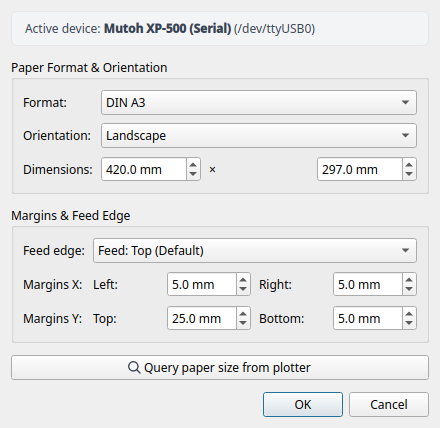
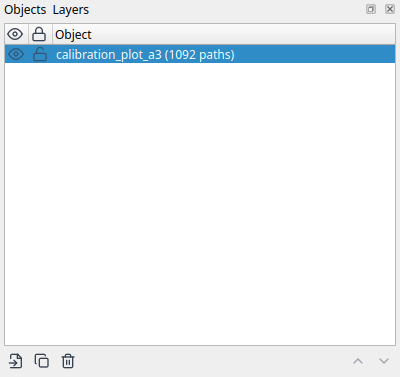
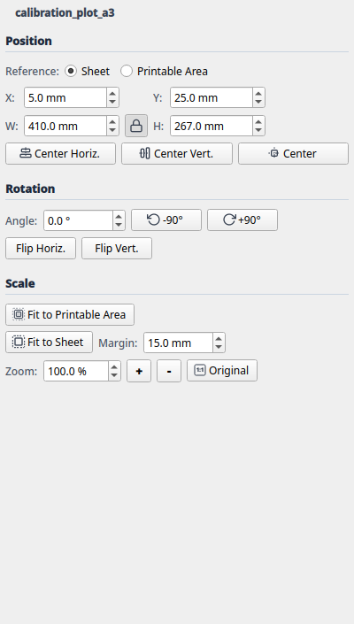

# 2. Layout Mode & Object Management

**Layout Mode** is LINTO's visual workspace. Here you arrange, scale, and rotate vector graphics on your selected sheet, assign pens and colors, and verify margins against your plotter's physical limits.

---

## 1. User Interface Overview

The interface is structured into clear functional zones:

1. **Main Canvas (Center):**
   * Displays the selected sheet scaled accurately in millimeters.
   * A **red dashed inner rectangle** marks the physically printable area (the *hard-clip window*). If any vector falls outside this boundary, LINTO warns you about potential clipping.
   * **Rulers (Top & Left):** Show millimeter measurements. The origin (0, 0) is at the top-left corner of the paper sheet.
   * **Mouse Navigation:**
     * **Scroll Wheel:** Smooth zooming in and out (centered on the mouse cursor).
     * **Middle Mouse Drag:** Pan the canvas.
     * **Left Click & Drag:** Select objects and move them directly.

2. **Top Toolbar & Device Bar:**
   * Mode switcher: toggle between **Layout Mode** and **Output Mode** (plot preview).
   * File actions: **Open** (`Ctrl+O`), **Save** (`Ctrl+S`), **Import** (`Ctrl+I`).
   * View controls: **Fit Sheet to Window** (`Ctrl+0`), **Zoom In** (`+`), **Zoom Out** (`-`).
   * Editing & Arrangement: Undo (`Ctrl+Z`), Redo (`Ctrl+Y`), Duplicate (`Ctrl+D`), Delete (`Del`), Rotate (90° CW/CCW), Center on sheet, Zoom to selection, 1:1 original size.
   * Quick button for **Page Setup** (shows active size, e.g. `DIN A3 Landscape`).
   * Device selector (e.g. *Mutoh XP-500 (Serial)*) and quick button for **Device Settings**.

3. **Right Tool Docks:**
   * **Objects & Layers Dock:** Tree view of all loaded documents, groups, and paths.
   * **Transform Dock:** Numerical control of position (relative to sheet or printable area), rotation, alignment, and scaling (zoom, 1:1 original, fit to sheet).
   * **Pens & Colors Dock:** Manage pen palette, speed, force, and tool assignments.
   *(Tip: When docks are grouped as tabs, the tab header serves as a compact title bar.)*

---

## 2. Sheet & Page Setup

Before placing artwork, configure your paper size and margin profile. Click **[ Page Setup... ]** in the top toolbar.

### Settings in the Dialog:
* **Standard Sizes:** Quick presets for DIN A4, A3, A2, A1, and A0.
* **Custom:** Free width and height input in millimeters (for non-standard sheets or roll paper cuts).
* **Orientation:** Toggle between **Portrait** and **Landscape**.
* **Margin Profile:**
  * *EXP (Expanded):* Minimal margins for maximum drawing area (default on Mutoh XP-500: 25 mm feed edge, 5 mm on the other three sides).
  * *NORM (Normal):* Larger safety margins (35 mm / 15 mm).
  * *TYPE1 / TYPE3:* Specialized profiles for roll media.
  * *default / minimal:* Symmetric margins for flatbed plotters and cutters.
* **Query Plotter (Live Hard-Clip):**
  If a plotter is connected via serial or TCP, clicking this button runs the HP-GL command `OH;` to query the exact sheet dimensions directly from the plotter's optical sensors. The format and printable area update automatically.

---

## 3. Importing Vector Artwork

LINTO supports two vector formats directly:
* **SVG (`.svg`):** The primary recommended format for vector artwork exported from Inkscape, custom scripts (Python, Processing, p5.js), Blender, Illustrator, Affinity Designer, or CAD tools. Smooth curves (Bézier curves, arcs) are preserved losslessly and linearized only during output compilation according to the configured tolerance.
* **HP-GL (`.hpgl`, `.plt`):** Direct import of existing machine plot files (including pen calls `SP1`–`SP8`, circles `CI`, arcs `AA`/`AR`, rectangles `EA`/`RA`, and `LB` text labels via the built-in 5×7 vector font).

### How to Import:
1. **Drag & Drop:** Drag one or more `.svg`, `.hpgl`, or `.plt` files directly from your file manager onto the canvas.
2. **Open Project / File (`Ctrl+O`):** Opens a project or vector file as a new document. If an SVG does not match a standard DIN format (e.g. 10×10 cm), the sheet dimensions adapt automatically to match.
3. **Import (`Ctrl+I`):** Adds more vector graphics as additional objects to the currently open layout.

### Automatic Color Clustering (SVG) & Pen Mapping (HP-GL)
* **SVG:** During import, LINTO analyzes stroke colors (`stroke`) and maps them to the 8 pen channels using a perceptual color distance metric (Delta-E in CIE-Lab color space).
* **HP-GL / PLT:** `SP1;`–`SP8;` instructions in the file are mapped directly to pens 1–8 in LINTO.

---

## 4. Objects & Layers Dock (Z-Order)

The **Objects & Layers** dock lists all loaded drawing elements in a tree structure.

### Controls and Features:
* **Visibility (Eye Icon):** Toggles an object or layer on/off. Hidden objects are neither rendered on the canvas nor sent to the plotter.
* **Lock (Lock Icon):** Prevents accidental moves, transforms, or deletion on the canvas.
* **Z-Order (Drawing Sequence):**
  * Objects higher in the list are drawn on top in the canvas.
  * Use **[ Move Up ]** and **[ Move Down ]** buttons to rearrange items.
  * *Tip:* Use Z-order to control which elements or colors are plotted first.
* **Management:**
  * **Double-click on name:** Rename the object inline.
  * **[ Duplicate ] (`Ctrl+D`):** Creates an offset copy of the selected object.
  * **[ Delete ] (`Del`):** Removes the object (fully undoable with `Ctrl+Z`).

---

## 5. Transform Dock

The **Transform** dock enables precise millimeter-accurate placement, rotation, alignment, and scaling across one or multiple selected objects.

### 1. Position:
* **Reference Frame:** Choose between **Sheet** (full paper dimension) and **Printable Area** (hard-clip window). All coordinates and alignment actions respect this frame.
* **X / Y (mm):** Exact position of the top-left bounding box corner of the selected object.
* **W / H (mm):** Exact width and height in millimeters.
* **Aspect Ratio Lock (Lock Icon):**
  * *Locked:* Changing width or height scales the opposite axis proportionally.
  * *Unlocked:* Allows non-proportional stretching.
* **[ Center Horiz. ]:** Centers selection horizontally relative to the reference frame.
* **[ Center Vert. ]:** Centers selection vertically relative to the reference frame.
* **[ Center ] (Crosshair):** Centers selection in the exact middle of the reference frame.

### 2. Rotation:
* **Angle (`°`):** Rotates all selected objects by any angle (`-360.0°` to `+360.0°`).
* **[ -90° ] / [ +90° ]:** Quick rotation by 90 degrees CCW or CW.
* **[ Flip Horiz. ] / [ Flip Vert. ]:** Mirrors selected objects horizontally or vertically around their center.

### 3. Scale:
* **[ Fit to Printable Area ]:** Proportionally scales the selection as large as possible within the printable area.
* **[ Fit to Sheet ] & Margin (mm):** Proportionally scales the selection to the sheet while preserving the configurable safety margin.
* **Zoom (%):** Numerical scale percentage (100.0% = original size).
* **[ + ] / [ - ]:** Step scaling in 10% increments (+10% / -10%).
* **[ Original ]:** Restores original 1:1 dimensions (100%) from the source file.

---

## 6. Pen Palette & Color Assignment

The **Pens & Colors** dock manages the plotter's 8 logical pen channels (including stroke width, plotting speed `VS` in `cm/s`, and pen force `FS` in `g`):

| Pen | Default Color | Hex Code | Recommended Use |
|---|---|---|---|
| **Pen 1** | Black | `#000000` | Main contours, lettering |
| **Pen 2** | Red | `#d32f2f` | Highlights, dimensions |
| **Pen 3** | Blue | `#1976d2` | Guidelines, hatching |
| **Pen 4** | Green | `#388e3c` | Secondary geometry |
| **Pen 5** | Orange | `#f57c00` | Shading, fill patterns |
| **Pen 6** | Magenta | `#7b1fa2` | Fine details |
| **Pen 7** | Cyan | `#0097a7` | Draft lines |
| **Pen 8** | Yellow | `#fbc02d` | Markers, accents |

Right-click any object on the canvas or pick a pen in the dock to reassign an object to any pen channel at any time.

---

> [!TIP]
> For instructions on creating optimal SVG scripts, using Inkscape or Blender as vector generators, and working with HP-GL or DXF files, see **[Chapter 6: Vector Formats, Sources & Workflows](6-vector-formats-and-workflows.md)**.
> 
> A curated directory of community tools (Awesome Plotters, Drawingbots, Inkcut, vpype, vsketch) is available in **[Chapter 8: Recommended Resources, Tools & Community](8-resources-tools-and-community.md)**.
