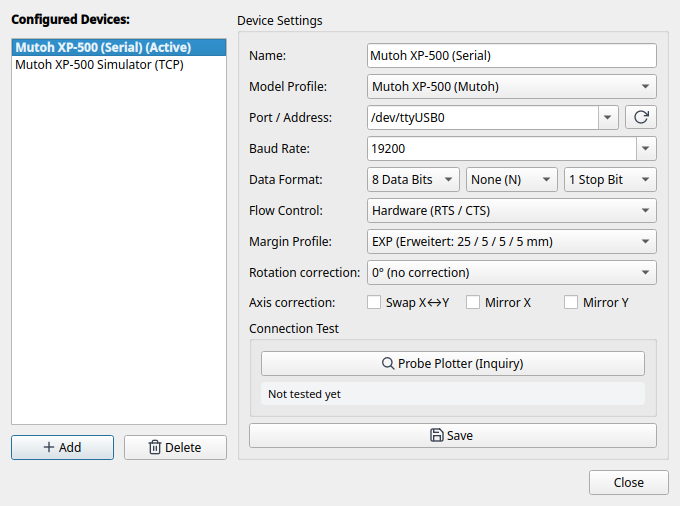
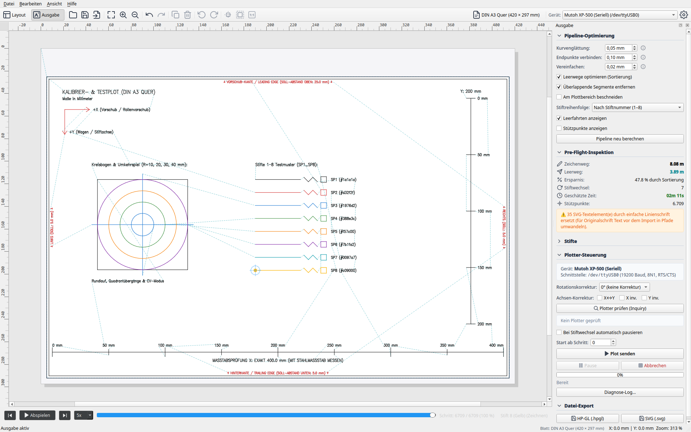

# 4. Hardware Setup, Calibration & Diagnostics

Here you will learn how to physically connect your pen plotter to your computer, configure serial interface parameters on the control panel and in the *Device Settings* dialog, test communication using the built-in diagnostic probe tool, and run the official calibration plot.

---

## 1. Physical Connection & Cabling

Classic plotters utilize RS-232 serial interfaces (typically 25-pin DB-25 or 9-pin DB-9 connectors). Modern computers usually lack native COM ports, requiring a USB-to-serial adapter.

### Recommended USB-to-Serial Adapters
* **Chipset:** Use adapters with genuine **FTDI** (e.g. FT232R, FT2232) or **Silicon Labs** (CP2102) chipsets.
* **Caution:** Inexpensive clone adapters lacking proper hardware RTS/CTS flow control will cause buffer overruns and data loss on larger vector drawings.

### Null-Modem Cabling with Genuine Hardware Handshake
Reliable communication strictly requires a full-handshake null-modem (crossover) cable:

| Signal | PC Side (DB-9 Female) | Plotter Side (DB-25 Male) | Plotter Side (DB-9 Male) | Description |
|---|---|---|---|---|
| **RxD** (Receive) | Pin 2 | Pin 2 (TxD) | Pin 3 (TxD) | Receive data line |
| **TxD** (Transmit) | Pin 3 | Pin 3 (RxD) | Pin 2 (RxD) | Transmit data line |
| **GND** (Ground) | Pin 5 | Pin 7 (GND) | Pin 5 (GND) | Signal ground |
| **RTS** (Request to Send) | Pin 7 | Pin 5 (CTS) | Pin 8 (CTS) | PC indicates readiness |
| **CTS** (Clear to Send) | Pin 8 | Pin 4 (RTS) | Pin 7 (RTS) | **Plotter throttles data flow (Handshake)** |
| **DTR** (Data Terminal Ready)| Pin 4 | Pin 6 (DSR) | Pin 6 (DSR) | Operational readiness |
| **DSR** (Data Set Ready) | Pin 6 | Pin 20 (DTR) | Pin 4 (DTR) | Operational readiness |

> **Important:** A simple 3-wire connection (only TxD, RxD, GND) without RTS/CTS is unreliable on pen plotters because the plotter must be able to pause the computer during complex mechanical movements.

### Alternative: TCP / Ethernet Device Servers
Instead of a direct USB cable, you can use serial-to-Ethernet converters (e.g. Moxa NPort, USR-TCP232) or a Raspberry Pi running `socat`. LINTO natively supports TCP network sockets via `tcp://<IP-Address>:<Port>` (e.g. `tcp://192.168.1.150:4001`).

---

## 2. Control Panel & DIP Switch Setup (Mutoh XP-500 Example)

Configure the following settings on your plotter's front control panel or DIP switches:

* **Emulation:** HP-7585B or MH-GL.
* **Baud Rate:** `19200` baud (or `9600` baud for very long cables).
* **Data Format:** `8` data bits, `None` parity, `1` stop bit (**8N1**).
* **Handshake / Flow Control:** **Hardware (RTS/CTS)**. *XON/XOFF must be disabled*.
* **Margin Profile:** **EXP** (Expanded).
* **Paper Loading:** After loading the paper, the optical sensor detects sheet edges automatically.

---

## 3. Device Settings Dialog

Open **Device → Settings...** from the menu or top toolbar to configure your plotter in LINTO:



* **Plotter List:** Displays all configured devices.
* **[ New Device ]:** Adds a new device configuration.
* **Per-Device Settings:**
  * **Display Name:** Custom label (e.g. `Mutoh XP-500 Studio` or `Roland DXY-1150 Flatbed`).
  * **Device Profile:** Base hardware model selected from the 25+ bundled profiles (e.g. `mutoh_xp500`, `roland_dxy`, `hpgl_generic`).
  * **Port & Baud Rate:** Serial port (e.g. `/dev/ttyUSB0`) or network address (`tcp://127.0.0.1:9999`), baud rate, parity, and flow control.
  * **Margin Profile:** Default margin configuration for the device.

> [!NOTE]
> To learn how to integrate additional plotter models, write custom YAML device profiles, or import drivers from Inkcut, see **[Chapter 5: Adding Custom Plotter Models & Device Profiles](5-custom-plotter-models.md)**.

---

## 4. Hardware Diagnostics with `tools/xp500_probe.py`

LINTO includes a standalone terminal diagnostic tool to verify the serial lines and inspect raw responses at the byte level:

```bash
# Probing via USB-Serial:
python3 tools/xp500_probe.py /dev/ttyUSB0

# Probing with custom baud rate and detailed ESC sequences:
python3 tools/xp500_probe.py /dev/ttyUSB0 --baudrate 19200 --esc

# Probing via network / TCP server:
python3 tools/xp500_probe.py tcp://127.0.0.1:9999
```

### Typical Output on a Successful Connection:
```text
=================================================================
  LINTO – Mutoh XP-500 Hardware-Diagnose (AP0)
=================================================================
Ziel:      /dev/ttyS5
Baudrate:  19200
Timeout:   0.6 s
-----------------------------------------------------------------
Verbindung: Serieller Port geöffnet. Signals: CTS=True, DSR=True

Abfrage-Ergebnisse (siehe docs/devices/mutoh-xp500/testplan.md):
-----------------------------------------------------------------
OI;      | Modell-Identifikation (Standard) | 7585B
OF;      | Zeicheneinheit (Units/mm)      | 40,40
OH;      | Plottbereich / Hard-Clip       | -3678,-5692,3679,5692
OS;      | Statusbyte                     | 26
OE;      | Fehlerstatus (HP-GL)           | 0
OA;      | Aktuelle Position & Stift      | -3077,-5092,0
OT;      | Stiftkarussell-Status          | 1,0
OO;      | Optionen                       | 0,1,0,0,1,1,0,1
ESC.A    | ESC.A (Erweiterte ID)          | 7585B
ESC.L    | ESC.L (Puffergröße)            | 1024
ESC.B    | ESC.B (Freier Puffer)          | 1024
ESC.O    | ESC.O (Erweiterter Status)     | 392
ESC.E    | ESC.E (Erweiterter Fehler)     | 0
-----------------------------------------------------------------

Auswertung:
• Modell:        7585B
• Auflösung:     40.0 Units/mm (Schrittweite: 0.0250 mm)
• Hard-Clip:     X: [-3678, 3679], Y: [-5692, 5692] Units
• Abmessungen:   183.9 × 284.6 mm (Plottbarer Bereich)
• Erkanntes Blatt: DIN A4
• Puffer:        Gesamt: 1024 Bytes, Frei: 1024 Bytes
=================================================================
```

If a timeout occurs or `CTS=False` is reported, check your null-modem cable, the settings on the plotter control panel (protocol/handshake), and the operating system setup instructions below.

---

## 5. Operating System Setup & Troubleshooting (RS-232)

### Linux

On Linux, serial interfaces are exposed as device nodes under `/dev/`. Depending on your hardware, there are several common pitfalls related to permissions, background services, or hardware interrupts.

#### 1. Identifying the Right Port Name (`/dev/ttyUSB*` vs. `/dev/ttyS*`)
* **USB-to-Serial Adapters** (FTDI, Silicon Labs CP210x, Prolific PL2303, CH340) appear as `/dev/ttyUSB0`, `/dev/ttyUSB1`, etc. (occasionally `/dev/ttyACM0`).
* **Onboard RS-232 & PCIe Serial Cards** (16550A-compatible UARTs) appear as `/dev/ttyS0`, `/dev/ttyS1`, etc. Because kernel drivers typically reserve `/dev/ttyS0` through `/dev/ttyS3` for motherboard headers, add-in PCIe cards often receive higher numbers such as `/dev/ttyS4` and `/dev/ttyS5`.

Use `dmesg` to inspect which serial ports the kernel detected at boot or when plugging in an adapter:
```bash
sudo dmesg | grep -E "ttyS|ttyUSB|ttyACM"
```
Example output with an onboard port (`ttyS0`) and a 2-port PCIe card (`ttyS4`, `ttyS5`):
```text
[    0.702046] serial8250: ttyS0 at I/O 0x3f8 (irq = 4, base_baud = 115200) is a 16550A
[    0.704314] 0000:04:00.0: ttyS4 at I/O 0xe010 (irq = 41, base_baud = 115200) is a 16550A
[    0.704696] 0000:04:00.1: ttyS5 at I/O 0xe000 (irq = 42, base_baud = 115200) is a 16550A
```

#### 2. Permission Denied (`Errno 13: Permission denied`)
By default, standard Linux user accounts do not have direct read/write access to `/dev/ttyS*` or `/dev/ttyUSB*`. Serial device nodes belong to the `dialout` group (Debian, Ubuntu, Linux Mint, Fedora, openSUSE) or `uucp` (Arch Linux, Manjaro).

1. **Check which group owns the port:**
   ```bash
   ls -l /dev/ttyS5
   # Example: crw-rw----. 1 root dialout 4, 69 Oct 19 15:40 /dev/ttyS5
   ```
2. **Add your user account permanently to the `dialout` group:**
   ```bash
   sudo usermod -aG dialout $USER
   ```
   > [!IMPORTANT]
   > Group membership changes on Linux only take effect after you **log out of your graphical desktop session completely and log back in** (or reboot).

3. **Immediate workaround without logging out (for the current session):**
   If you do not want to log out right away, you can grant your user temporary read/write access until the next reboot:
   ```bash
   sudo setfacl -m u:$USER:rw /dev/ttyS5
   ```

#### 3. PCIe Serial Cards & Interrupt Issues (`No irq handler` / Timeout)
When using add-in PCIe RS-232 expansion cards (such as cards based on the common **ASIX AX99100** chip `[125b:9100]`, MosChip MCS99xx, or WCH CH382), the generic Linux kernel driver (`8250_pci`) may create `/dev/ttyS4` / `/dev/ttyS5` and read status lines (`CTS=True`, `DSR=True`) properly, yet every query or data transfer fails with a **timeout**.

* **Typical Symptom:** When accessing the port, the system log (`journalctl -kf` or `dmesg`) prints a kernel message such as:
  ```text
  kernel: No irq handler for 13.32
  ```
* **Cause:** Hardware interrupt routing (MSI/APIC) between the PCIe card and the `8250_pci` driver fails. Although the UART receives the plotter's reply into its hardware FIFO, it cannot trigger a CPU interrupt to notify the kernel.
* **Workaround (`setserial` Polling Mode):**
  By setting the serial port's IRQ to `0` using `setserial`, the Linux kernel bypasses hardware interrupts for that port and switches to reliable **timer-based polling**:
  ```bash
  # Install setserial (if not already installed):
  sudo dnf install setserial   # Fedora / RHEL
  sudo apt install setserial   # Debian / Ubuntu

  # Switch the port to polling mode (IRQ 0):
  sudo setserial /dev/ttyS5 irq 0

  # Verify the setting:
  setserial -a /dev/ttyS5
  ```
* **Making the setting persistent across reboots (udev rule):**
  Because `setserial` settings reset on reboot, you can automate them by creating `/etc/udev/rules.d/99-serial-polling.rules`:
  ```udev
  ACTION=="add", SUBSYSTEM=="tty", KERNEL=="ttyS4", RUN+="/bin/setserial /dev/%k irq 0"
  ACTION=="add", SUBSYSTEM=="tty", KERNEL=="ttyS5", RUN+="/bin/setserial /dev/%k irq 0"
  ```

#### 4. Common Conflicts with USB-to-Serial Adapters (`brltty` & `ModemManager`)
* **`brltty` hijacking USB adapters:** Many Linux distributions (Ubuntu, Debian, Fedora) ship with the `brltty` Braille display daemon enabled by default. Its udev rules mistakenly identify some USB-to-serial adapters (especially FTDI and CH340) as Braille displays and disconnect `/dev/ttyUSB0` seconds after plugging it in (`dmesg` shows `interface 0 claimed by ftdi_sio while 'brltty' sets config #1` / `ttyUSB0: now disconnected`).
  * *Fix (if you do not use a Braille display):* Disable or uninstall `brltty`:
    ```bash
    sudo systemctl stop brltty.path brltty.service
    sudo systemctl mask brltty.path brltty.service
    ```
* **`ModemManager` probing ports with `AT` commands:** Immediately after plugging in a USB-to-serial adapter, `ModemManager` may probe the port for a few seconds to check if it is a cellular modem. Wait 5–10 seconds after plugging in the USB adapter, or power on the plotter after connecting the adapter so `AT` probe strings do not trigger an HP-GL syntax error on the plotter.

#### 5. Quick Manual Console Test (`stty` & `cat`)
To test whether the serial port, cable, and plotter communicate at the OS level independently of Python or LINTO, you can configure and send data directly from a terminal (`19200` baud, `8N1`, `crtscts` hardware flow control):

```bash
stty -F /dev/ttyS5 19200 -parenb cs8 -cstopb crtscts
cat Hello-World.hpgl > /dev/ttyS5
```

---

### macOS

* **Device Names:** USB-to-serial adapters appear twice under `/dev/` on macOS—as `/dev/tty.usbserial-*` and `/dev/cu.usbserial-*`. Always prefer the **`/dev/cu.*`** (*Call-Up / Call-Out*) device in LINTO, because `/dev/tty.*` waits for the hardware Data Carrier Detect (DCD) line and may block when opening.
* *(Additional macOS-specific notes will be added in a future update.)*

---

### Windows

* **Device Names:** On Windows, serial ports are addressed as `COM1`, `COM2`, `COM3`, etc. You can check which COM port number was assigned to your USB-to-serial adapter or PCIe card in **Device Manager** under *Ports (COM & LPT)*.
* *(Additional Windows-specific notes will be added in a future update.)*

---

## 6. The Calibration Plot (Accuracy, Margins, Pens & Backlash)

Pre-compiled calibration patterns for DIN A4 and DIN A3 are located in `resources/`:
* `resources/calibration_plot_a3.svg` / `.hpgl`
* `resources/calibration_plot_a4.svg` / `.hpgl`



### Calibration Features & Verification Criteria:

1. **Orientation Arrows (+X / +Y) & Edge Markers:**
   * An arrow marked `+Y` and text `TOP / LEADING EDGE` is drawn at the feed edge.
   * *Check:* Was the text drawn upside-down or mirrored? If so, adjust `invert_x`, `invert_y`, or `rotation_deg` in the device profile.
2. **Precision Measurement Line (400 mm for A3 / 200 mm for A4):**
   * A continuous measurement line with precise end ticks.
   * *Check:* Measure the drawn line with a quality **steel ruler**.
   * If the line measures exactly 400.0 mm, stepper resolution is calibrated at 40.0 units/mm. Any variance can be fine-tuned via `units_per_mm` in the profile.
3. **Outer Hard-Clip Border:**
   * Traces a rectangle along the plotter's maximum printable limits.
   * *Check:* Are all 4 borders drawn cleanly without the pen running over pinch rollers or the carriage hitting mechanical limits?
4. **8-Pen Matrix:**
   * 8 labeled test boxes with colored hatch fills.
   * *Check:* Does the pen carousel change each pen smoothly? Do pen caps seal tightly?
5. **Concentric Circles & Square-in-Circle (Backlash Check):**
   * Concentric circles enclosing a centered square.
   * *Check:*
     * Do circle start and endpoints align perfectly?
     * Are circles round or egg-shaped/elliptical?
     * Quadrant shifts indicate mechanical backlash in drive belts or pinch wheels.
