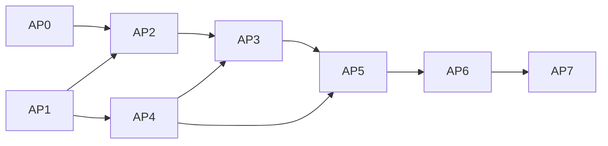

# Arbeitspakete & Meilensteine

Stand: 2026-10-14 (v2.2) · Basis: [konzept.md](konzept.md) v2.2
Aufwand: S ≈ 1–3 Abende, M ≈ 1–2 Wochenenden, L ≈ mehrere Wochenenden.

## Meilensteine

| Meilenstein | Inhalt | Nutzen |
|---|---|---|
| **M0 – Hardware verstanden** | AP0 | vollständig verifiziertes Geräteprofil |
| **M1 – CLI-Plot** | AP1–AP4 | SVG → Blatt plotten ohne GUI, mit Blatterkennung, Optimierung, Fortschritt, Abbruch, Resume |
| **M2 – GUI Phase 1** | AP5–AP6 | Importieren & Anordnen, Stifte, Pre-Flight-Vorschau, Gerätesteuerung |
| **M3 – GUI Phase 2** | AP7 | Objekte innerhalb von Importen selektieren, verändern, löschen |
| später | Ideenspeicher (konzept.md §9) | Text, Schraffur, weitere Treiber … |

---

## AP0 – Hardware-Spike Mutoh XP-500 (S) ⚠️ zuerst
Bereits bekannt (siehe [devices/mutoh-xp500/](../devices/mutoh-xp500/README.md)): Schnittstelle, Handshake, `OI`=7585B, `OF`, `OH`-Werte, Ursprung, Achsen, Randsummen. Aus MutohPlot außerdem: Hard-Clip-Fenster, Puffer-Einstellung 1 MB/1000 Zeichen, Achsabbildung, Abbruch über LOCAL/RESET.

Noch offen. Zuerst Panel und Handbuch, dann mit Skript `tools/xp500_probe.py` (pyserial) prüfen:
0. **Panel-Einstellungen notieren:** Hard-Clip-Fenster (Norm/Exp/Type 1/Type 3), Empfangspuffer (1 MB/1000 Zeichen), Befehlsmodus/Auflösung (warum `OF` = 40 statt 100 wie bei MutohPlot?), Vektorsortierung.
   **Querprüfung:** MutohPlot lokal installieren und einen Kalibrierplot damit ausgeben. Einheit beachten, ggf. `--device-unit 0.025`.
1. **Puffer:** `ESC.L` (Puffergröße), `ESC.B` (freier Puffer), Antwort-Terminator (`ESC.M`). Verhalten mit 1000-Zeichen-Puffer und RTS/CTS.
2. **Abbruch:** verwirft `ESC.K` den Puffer? Wie verhält sich die Pause-Taste?
3. **Sync:** Antwortet `OA;` erst, wenn die vorherigen Befehle ausgeführt sind?
4. **Befehle:** `VS v,pen`, `FS`, `AS`, `CI`, `PR`, maximale Punkte pro `PD`. Bedeutung von `OT;`.
5. **Firmware-Vektorsortierung**: an/aus und Wirkung.
6. **Orientierungsplot:** Pfeile „+X/+Y“, Beschriftung der Ecken, Blatt-Oberkante markieren → `insert_matrix` (Kandidat aus MutohPlot bestätigen).
7. **Randplot (4-Rand-Kalibrierung wie MutohPlot):** Rechteck exakt auf dem Hard-Clip plotten, Abstände zu allen vier Blattkanten messen (A4, A3, A2, je beide Lagen) → Ränder je Kante, Abgleich mit Fenstertabelle. Klärt auch die Tabellen-Widersprüche.
8. **Maßhaltigkeit:** Rahmen 1000 × 700 mm auf A0 (bzw. 500 × 350 auf A2) + Kreuze, mit Stahlmaß messen → `scale_x/y`.
9. **Bewegungsmessung:** Linien 1/10/100/500 mm, Zeiten messen, Stiftwechsel stoppen → `motion`.

**Ergebnis:** `resources/devices/mutoh_xp500.yaml` (alle `?` aufgelöst) + Abschnitt „Verifizierte Fakten“ ergänzt.

> [!TIP]
> Bis Plotter Studio plotten kann, lässt sich **MutohPlot als Übergangswerkzeug** nutzen (`mutohplot web` lokal).

## Übernahmen aus MutohPlot (MIT, Hinweis beibehalten)
| AP | Modul | Zweck |
|---|---|---|
| AP2 | `hard_clip.py`, `transform/hard_clip.py`, `calibration*.py` | Fenstertabelle, Mittelpunktkorrektur, Kalibrierzeichnung und -profil |
| AP3 | `serial_io.py` | Userspace-XON/XOFF, `OF`/`OH`-Abfrage |
| AP4 | `hpgl/tokenizer.py`, `hpgl/parser.py`, `hpgl/stroke_font.py` | HP-GL-Import |
| AP4 | `optimize/paths.py` (Dedupe) | Duplikate erkennen und entfernen |
| alle | passende Tests | Referenzfälle |

## AP1 – Core: Polylinien & Geometrie (M)
- **Schlanker numpy/scipy-Kern (Entscheidung D-15):** Eigener Polylinien-Datentyp (`ndarray`). Algorithmen (Bézier-Diskretisierung, Endpunkt-Merge, KD-Tree 2-Opt) orientieren sich an den Konzepten von vpype/MutohPlot als Ideen- und Algorithmen-Ressource, jedoch ohne externe Monster-Abhängigkeiten.
- Polylinien-Datentyp (numpy), Stift-Zuordnung.
- Adaptive Bézier-/Bogen-Diskretisierung mit Sehnentoleranz.
- Affine Transformationen, Bounding Boxes, Statistik (Längen, Leerweg).
- Unit-Tests (pytest + hypothesis).

**Abnahme:** Kreis r = 100 mm bei 0,05 mm Toleranz → max. Abweichung ≤ 0,05 mm, minimale Punktzahl.

## AP2 – Device: Profil, Abbildung, Blatterkennung, HPGL-Emitter (M) – ✅ Umgesetzt
- YAML-Profil + Pydantic-Validierung (`resources/devices/mutoh_xp500.yaml`, `src/plotter_studio/device/profile.py`).
- Abbildung Papier-mm → Units nach konzept.md §4 (Center-Origin, asymmetrische Ränder EXP/NORM/TYPE1/TYPE3).
- Blatterkennung aus `OH` (Format + Lage).
- Emitter (7585B): `IN`, `SP`, `VS`, `FS`, `PU`, `PD` mit Koordinatenketten und Schritt-Indizes.
- Vollständig abgedeckt durch Unit- und Golden-Tests (`tests/test_device_streaming.py`).

## AP3 – plotd / Streaming & Virtual Plotter (M–L) – ✅ Umgesetzt
- Serieller Transport über pyserial (`rtscts`) sowie TCP-Sockets (`tcp://host:port`).
- **Virtueller Mutoh XP-500 Software-Emulator** (`src/plotter_studio/emulator/`) mit PTY- und TCP-Server, Inquiry-Beantwortung (`OI;OF;OH;`) und SVG-Aufzeichnung.
- Hintergrund-Streaming (`SerialStreamer`), Pause/Resume und sofortiger Abbruch (`ESC.K`, `PU;SP0;`).
- Schnittstellenerkennung (`list_serial_ports()`) für reale Ports, PTY-Symlinks und TCP.

## AP4 – Pipeline, Optimierer, Import, Schätzer (M) – ✅ Umgesetzt
- SVG-Import mit Stiftzuordnung und Einheitenumrechnung.
- Pipeline: Adaptive Bézier-Glättung, Endpunkt-Merge, RDP-Vereinfachung, KD-Tree Greedy + 2-Opt-Wegoptimierung, optionales Clipping.
- Pre-Flight-Statistiken: Zeichenweg, Leerweg, Sortier-Ersparnis, Stiftwechsel, Dauer.
- HP-GL- und Plot-SVG-Export.

## AP5 – GUI Phase 1: Layout-Modus (L) – ✅ Umgesetzt
- Hauptfenster (PySide6), Canvas mit Blattanzeige, Linealen, Zoom/Pan, WYSIWYG-Strichbreiten.
- Dokumentmodell mit Undo/Redo, Presets (A4–A0) und Ränderanzeige.
- Stift-Panel mit dynamischer Farbzuordnung, Geschwindigkeit und Anpressdruck.
- Drag & Drop und Transform-Werkzeuge.

## AP6 – GUI Phase 1: Plot-Modus & Gerätesteuerung (M–L) – ✅ Umgesetzt
- Umschaltung zwischen Layout- und Plot-Modus.
- Pre-Flight-Vorschau mit Leerfahrten, Stützpunkt-/Knotenanzeige und Scrubber-Simulation.
- Integriertes Gerätepanel:
  - Portauswahl (Seriell / TCP / virtueller Plotter) mit Auto-Refresh.
  - Randprofil-Auswahl (EXP, NORM, TYPE1, TYPE3).
  - Plotter-Prüfung (`[ 🔍 Plotter prüfen ]`) mit Hardware-Inquiry (`OI;OF;OH;`) und Blatterkennung.
  - Live-Steuerung: `[ 🚀 Plot senden ]`, `[ ⏸ Pause ]`, `[ ⏹ Abbrechen ]`.
  - Fortschrittsanzeige mit synchroner Canvas-Toolhead-Aktualisierung in Echtzeit.

**Abnahme M1 & M2 erreicht!**

## AP7 – GUI Phase 2: Objekte bearbeiten (M)
- Objekt-Panel (Baum), Gruppe „betreten“, Unterauswahl, Transformieren, Stift zuweisen, Löschen.

**Abnahme = M3.**
