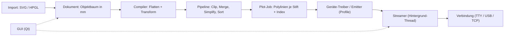
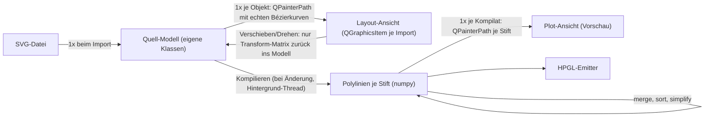
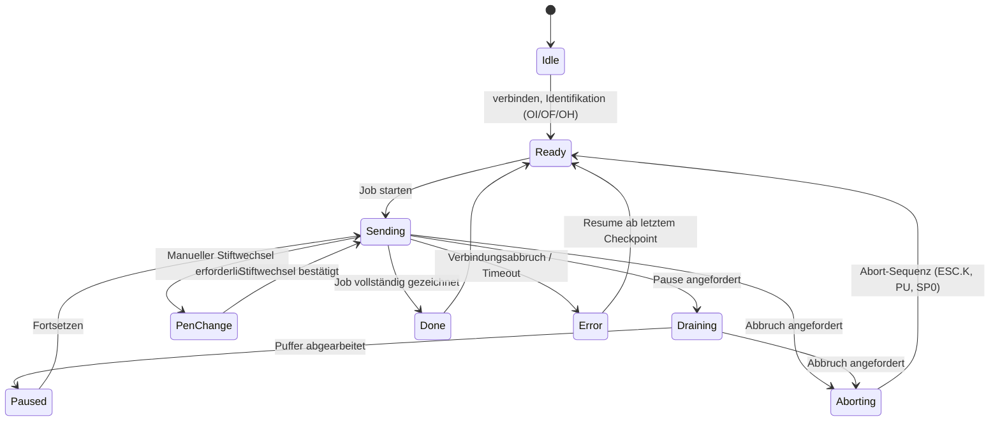

# Plotter Studio – Konzept v2.4

Stand: 2026-10-18 · Status: **Gelebte Architektur & Systementwurf v2.4**
Gerätedokumentation: [devices/mutoh-xp500/](../devices/mutoh-xp500/README.md).
Roadmap & Aufgaben: [TODO.md](TODO.md).

Änderungen zu v2.3:
- **Streaming im Hintergrund-Thread statt eigenem Dienst:** `plotd` als separater Prozess ist nicht nötig und wandert in den Ideenspeicher (§6.1, §9).
- **Gerät als Wahrheitsquelle:** Was der Plotter meldet (`OF;`, `OH;`), gilt. Profilwerte sind nur Fallback (§4.2a).
- **Achsenmodell XP-500 bestätigt:** Die Einlage-Matrix ist fest und hängt nicht von der Papierlage ab (§4.3).

Änderungen zu v2.1:
- **Multi-Geräte-Architektur geschärft:** Vollständig getrennter Kern (`core`, `pipeline`, `device`), ansteuerbar für beliebige Stiftplotter (HP-GL, MH-GL, HP-GL/2, Roland, G-Code/GRBL wie AxiDraw). Mutoh XP-500 ist Referenz- und Erstzielgerät.
- **Beliebige Papierformate (Custom Sheet Sizes):** Papiergröße hängt beim XP-500 von den manuell verschiebbaren Andruckrollen ab; jedes Format ist möglich. Trennung zwischen Dokumentformat (DIN oder frei) und gemessenen Hard-Clip-Grenzen.
- **Erkenntnisse aus Handbuch Kap. 7 eingearbeitet:** Einstellbare Zeicheneinheit (0,025 mm vs. 0,010 mm), Pufferumschaltung am Panel (`Small` = 1000 Zeichen), Firmware-Sortierung (`Sort: Off`), Stiftparameter (`VS, AS, FS: Good`), Hard-Clip-Ränder laut Abb. 7.3.
- **Bandbreiten- und Streaming-Strategie:** Optimierung für serielle Engpässe (Koordinatenketten, relative Koordinaten `PR`).

---

## 1. Vision & Positionierung

**Plotter Studio ist ein modularer „Slicer für Stiftplotter“ unter Linux.**
Analog zu PrusaSlicer/Cura beim 3D-Druck: Inhalte **importieren → auf beliebigem Medium anordnen → Stifte/Werkzeuge zuordnen → optimieren & prüfen → zuverlässig an das Gerät senden**.

### Multi-Geräte-Strategie (Geräteunabhängigkeit)
Obwohl das Projekt primär für den vorhandenen **Mutoh XP-500** entwickelt wird, ist die gesamte Softwarearchitektur **strikt hersteller- und geräteneutral** entworfen:
- **Geräteunabhängiger Kern:** Dokumentenmodell, Importe, Gruppierung, Pfadtransformationen, Optimierungs-Pipeline (Clipping, Vereinfachung, 2-Opt-Sortierung) und Werkzeugverwaltung arbeiten rein in metrischen Koordinaten (Millimeter).
- **Geräte-Abstraktion (`plotter_studio.device`):** Trennt *Geräteprofil* (YAML), *Koordinatenabbildung* (Center- vs. Corner-Origin, Ausrichtung), *Protokoll-Treiber* (Emitter für HP-GL, MH-GL, G-Code etc.) und *Fähigkeiten* (Capabilities wie Abfragemöglichkeiten, Puffertiefe, Werkzeugwechsel).
- **Streaming (`plotter_studio.device.streamer`):** Sendet im Hintergrund-Thread über serielle TTYs, USB-Seriell-Adapter oder TCP-Sockets, mit konfigurierbarer Flusskontrolle (Hardware-Handshake, XON/XOFF im Userspace).

**Referenzgerät Mutoh XP-500:**
Großformat-Stiftplotter (A4 bis A0 sowie beliebige Zwischengrößen dank verschiebbarer Andruckrollen). Meldet sich als HP-7585B-Emulation (MH-GL / HP-GL), RS-232 mit bis zu 19200 Baud 8N1 und Hardware-Handshake (DTR/CTS) über USB-Seriell-Adapter, 8 Stifte.

### Funktionsumfang nach Phasen

| Phase | Umfang |
|---|---|
| **1 – Importieren & Anordnen** | SVG- (und HP-GL-)Dateien als **ganze Objekte** importieren, auf dem Blatt platzieren (verschieben, skalieren, drehen, zentrieren, einpassen, numerisch), Standard- und freie Formate, Stifte zuordnen, Vorschau mit Leerfahrten, optimieren, plotten |
| **2 – Objekte bearbeiten** | Einzelne Pfade/Gruppen *innerhalb* von Importen selektieren, verändern (transformieren, anderen Stift zuweisen) und löschen |
| **später / Ideen** | Zeichenwerkzeuge, Text (Hershey), Schraffur, Rollenmedien, weitere Gerätetreiber (G-Code, Roland) (§9) |

Nicht-Ziele: Vollwertiges Vektor-Zeichenprogramm (kein Inkscape-Ersatz), Schneideplotter-Funktionen.

### Leitprinzipien
1. **Headless first:** Alles außer der Darstellung läuft ohne GUI (CLI, Skripte, Tests, automatisierte Pipelines).
2. **Nicht-destruktiv:** Importe bleiben als Objekte mit ihrer inneren Struktur erhalten. Linien entstehen erst beim „Kompilieren“.
3. **Was der Plotter meldet, gilt:** Gerätespezifika liegen in Profilen, werden aber – wo möglich – vom Gerät abgefragt (Einheiten via `OF;`, plottbarer Bereich via `OH;`). Abgefragte Werte haben immer Vorrang vor Profilwerten (§4.2a).
4. **Lange Jobs sind der Normalfall:** Ein mehrstündiger Großformat-Plot darf nicht durch Bedienfehler (Fenster schließen, Moduswechsel) verloren gehen und muss sich nach einem Abbruch fortsetzen lassen.

---

## 2. Gesamtarchitektur



### Pakete / Schichten

| Paket | Qt? | Inhalt |
|---|---|---|
| `plotter_studio.core` | nein | Dokumentmodell, Geometrie, Import/Export (SVG, HP-GL), Stifte, Persistenz |
| `plotter_studio.pipeline` | nein | Flatten, Clip, Merge, Simplify, Sort, Compiler → Plot-Job |
| `plotter_studio.device` | nein | Profile (YAML), Emitter (HP-GL/MH-GL), Koordinatenabbildung (Center/Corner-Origin, Einlage), Geräteabfrage (`probe`), Streamer mit Flusskontrolle, Geräteverwaltung |
| `plotter_studio.emulator` | nein | Virtueller XP-500 (PTY/TCP) für Tests ohne Hardware |
| `plotter_studio.gui` | **ja** | Hauptfenster, Canvas, Docks, Dialoge. Hängt nur von den Paketen oben ab. |

Abhängigkeitsregel: `gui → (core, pipeline, device)`, niemals umgekehrt. Alles außer der GUI läuft ohne installierte Qt-Bibliotheken.

### Technologie
- **Lizenz: GPLv3** (entschieden).
- Python ≥ 3.11, **numpy** (vektorisierte Geometrie, Clipping & Pfadoptimierung), **svgelements** (SVG-Parsing), **pyserial** (headless statt QSerialPort), **pyyaml** (Profil- und Konfigurations-Persistenz), **pytest**.
- GUI: **PySide6** (offizielles Qt-Binding).
- **vpype:** Wird **nicht** als Bibliothek eingebunden (zu schwergewichtig, kein nativer Library-Modus). Dient stattdessen als **Ideen- und Algorithmen-Ressource** für den schlanken, eigenen Geometriekern (`numpy`).
- **MutohPlot** (MIT): Gerätewissen und Algorithmen (HP-GL-Parser, Hard-Clip-Berechnungen, Kalibrierung, Userspace-XON/XOFF) werden portiert (mit Erhalt des MIT-Lizenzhinweises), ohne externe Paketabhängigkeit. Details: [analyse-mutohplot.md](analyse-mutohplot.md).


---

## 3. Datenmodell

### 3.1 Zwei Ebenen

| Ebene | Zweck | Repräsentation |
|---|---|---|
| **Quell-Objekte** | Was der Nutzer anordnet/bearbeitet | Objektbaum: Importe (mit erhaltener innerer Struktur), Gruppen, Pfade, Transformationen |
| **Kompilierte Geometrie** | Was der Plotter zeichnet | je logischem Stift eine Liste von Polylinien (`ndarray[N,2]`, float, mm) |

Die GUI zeigt im **Layout-Modus** die Quell-Objekte, im **Plot-Modus** die kompilierte, optimierte Geometrie inkl. Leerfahrten.

### 3.2 Objektbaum

```
Document
├── page: Page            (preset: "A3" | "Custom", width_mm: float, height_mm: float, orientation: "portrait"|"landscape")
├── pens: [LogicalPen]    (id, name, display_color, width_mm, tool_hint)
├── root: Group
│   ├── Import "logo.svg"   transform=…   source=pfad + hash, eingebettete Kopie
│   │   ├── Group (aus SVG)
│   │   │   ├── Path  pen=1  segments=[M, C, L, A, Z …]
│   │   │   └── Path  pen=2
│   │   └── Path pen=1
│   └── Import "plan.hpgl"  transform=…
└── plot_settings: tolerance_mm, merge_tolerance_mm, sort, pen_order, clip
```

- **Beliebige Papierformate (Custom Formats):** Neben DIN A4–A0 unterstützt das Datenmodell beliebige Maße in Millimetern. Das Format kann entweder manuell frei vorgegeben oder direkt aus dem am Gerät gemessenen Bereich (`OH;`) übernommen werden („Aus Plotter übernehmen“).

- **Phase 1:** Nur die Import-Knoten der obersten Ebene sind interaktiv (transformieren, löschen). Die innere Struktur bleibt trotzdem erhalten, damit Phase 2 ohne Modellwechsel auskommt.
- **Stift ist Attribut**, nicht Container (Review B1). Bei SVG-Import erfolgt die Zuordnung über Strichfarbe oder Ebenenname, umstellbar im Stift-Panel.
- **Transform** pro Knoten (affine 2×3), verschachtelt wie in SVG.
- **Sichtbar / nicht plotten** pro Stift und pro Import.
- **Undo/Redo:** Kommando-Muster im Kern (`core.commands`). Die GUI bindet es an `QUndoStack`.

### 3.3 Stifte: logisch → Werkzeug → Slot

```
Dokument            Werkzeugbibliothek (global)         Karussell (Gerätezustand)
LogicalPen 1 ───►   rotring_035_schwarz  ───────────►   Slot 1
LogicalPen 2 ───►   fineliner_rot        ───────────►   Slot 3
LogicalPen 9 ───►   staedtler_blau       ───────────►   (manuell → Wechsel-Dialog)
```

- **Werkzeug** (`tools.yaml`): Typ, Breite, Farbe, `speed_cm_s`, `force` (falls unterstützt), `max_draw_m` (Nachfüllwarnung).
- **Karussell-Belegung** wird gespeichert. Beim Plotten ordnet ein Dialog die logischen Stifte den Slots zu (automatisch per Werkzeug/Farbe).
- **Strichmeter-Zähler** je Werkzeug.
- Max. 8 Stifte pro Plot (Antwort Q-11), ein Wechsel-Dialog für mehr als 8 Stifte ist daher nicht nötig.
- Weil viele verschiedene Stifte ausprobiert werden (Tusche, Bleistift …), ist die **Werkzeugbibliothek schon in Phase 1 nützlich**. Mindestens Name, Typ, Farbe, Breite und **Geschwindigkeit pro Werkzeug** (`VS v,pen`), dazu ein **Stifttest-Plot** (Linien und Kreise bei verschiedenen Geschwindigkeiten) zum Ausprobieren neuer Stifte.
- Phase 1 darf vereinfachen: logischer Stift n = Slot n.

### 3.4 Stift-Zuweisung, Farbreduktion & flexibles Remapping

Die Zuordnung von Grafikelementen zu Stiften muss für reale Plot-Workflows maximal flexibel und jederzeit revidierbar sein:

```
Quelldatei (SVG)                     Dokument / Stift-Mapping                Plot-Job
┌──────────────────────┐             ┌─────────────────────────────┐        ┌─────────────┐
│ Inkscape-Ebene 1     │ ──────────► │ Stift 1 (0,25 mm, Schwarz)  │ ─────► │ HP-GL SP 1  │
│ Inkscape-Ebene 2     │ ───┐        └─────────────────────────────┘        └─────────────┘
│ Konturfarbe #d32f2f  │ ───┼──────► ┌─────────────────────────────┐        ┌─────────────┐
│ Pfade Gruppe B       │ ───┘        │ Stift 2 (0,50 mm, Rot)      │ ─────► │ HP-GL SP 2  │
│ 12 Farbnuancen       │ ───(Cluster)┤                             │        └─────────────┘
└──────────────────────┘             └─────────────────────────────┘
```

#### 1. Erkennung beim Import
Beim Importieren einer SVG-Datei analysiert Plotter Studio Struktur und Stile:
- **Nach Ebenen (Inkscape-Layer):** Inkscape speichert Ebenen als Gruppen `<g inkscape:groupmode="layer" inkscape:label="...">`. Diese Labels und Gruppen können direkt als logische Stift-Layer übernommen werden.
- **Nach Konturfarben (`stroke`):** Scan aller distinkten Konturfarben im SVG. Füllungen (`fill`) werden ignoriert (mit Warnhinweis im Pre-Flight).
- **Auto-Farbreduktion (Clustering auf $\le 8$ Farben):** Besitzt ein SVG mehr als 8 Farben (oder viele feine Helligkeitsabstufungen), fasst ein Clustering-Algorithmus (CIELAB $\Delta E$ Farbabstand / k-Means) ähnliche Farben automatisch auf die maximal 8 verfügbaren Stifte zusammen.

#### 2. Jederzeit anpassbares Mapping (Non-Destructive Remapping)
Das Stift-Mapping ist **nicht-destruktiv** und kann **jederzeit im Stift-Panel geändert werden**, ohne die Originalgrafik neu importieren zu müssen:
- **Reduktion auf weniger Stifte:** Ein 8-farbiges SVG kann mit einem Klick auf 4, 2 oder **1 Stift (monochrom)** zusammengelegt werden (z. B. Button „Alle Farben auf Stift 1 zusammenführen“).
- **Stift-Merging:** Im Stift-Panel kann Stift $A$ auf Stift $B$ umgeleitet werden (z. B. Dunkelblau und Schwarz zusammen auf den schwarzen Tuschestift).
- **Manuelle Zuweisung per Selektion:** Jedes selektierte Objekt (oder Gruppe) im Canvas kann über das Stift-Panel oder Tastenkürzel (`1`–`8`) direkt einem anderen Stift zugewiesen werden.

#### 3. Konfigurierbare Stift-Darstellung (WYSIWYG)
Jeder logische Stift besitzt zwei zentrale Darstellungseigenschaften:
- **Anzeigefarbe (`display_color`):** Frei wählbar (Hex-Farbwert), unabhängig von den SVG-Farben der Quelldatei, damit die Bildschirmanzeige exakt der echten Tinte entspricht (z. B. Königsblau, Graphitgrau, Gold).
- **Physische Strichbreite (`width_mm`):** Echte Strichbreite in Millimetern (z. B. $0{,}25\text{ mm}$, $0{,}50\text{ mm}$, $0{,}80\text{ mm}$).
  * *Nutzen:* Maßhaltige WYSIWYG-Vorschau im Canvas. Zeigt sofort, ob dichte Schraffuren oder Linienbündel auf dem Papier ineinanderlaufen und Tintenflecken verursachen.
  * *Sichtbarkeit:* Stifte können einzeln ausgeblendet oder vom Plotten ausgeschlossen werden.

### 3.5 Persistenz ⟨Q-08⟩
Vorschlag: **Projektdatei = SVG mit eigenem XML-Namespace** (`ps:`). Importe werden eingebettet (plus Pfad/Hash der Quelle für „neu laden“), Stift- und Plot-Einstellungen liegen als `ps:`-Metadaten. Jeder SVG-Viewer zeigt das Projekt an. Alternative: JSON.
Anforderung (Antwort Q-08): Die Anzeige wird eventuell zu einem einfachen Editor ausgebaut. Das Format muss also **Editor-Objekte** (später z. B. Rechteck, Text, Gruppen mit Eigenschaften) verlustfrei speichern können. Dafür wird ein **versioniertes Schema** (`ps:version`) verwendet, und das **Modell ist führend**: Die SVG-Datei ist die Serialisierung des Modells, nicht umgekehrt. Fremde SVG-Dateien werden *importiert*, nicht als Projekt geöffnet.

### 3.6 Datenfluss: Modell ↔ Qt ↔ Linien-Ebene

**Grundsatz:** `QGraphicsScene` ist eine **Ansicht**, nicht das Datenmodell. Die Linien-Ebene (schlanker Geometriekern in numpy) ist eine **Einbahnstraße** vom Modell zum Plotter. Es gibt **keine Konvertierung pro Bedienschritt**.



| Bedienschritt | Was passiert | Konvertierung? |
|---|---|---|
| Import | SVG → Modell. Für die Anzeige wird einmal ein `QPainterPath` je Import erzeugt. | einmalig |
| Verschieben/Skalieren/Drehen (Phase 1) | `QGraphicsItem.setTransform()`. Das Modell speichert nur die neue 2×3-Matrix. | **keine** Geometrie-Konvertierung |
| Pfad löschen / Stift ändern (Phase 2) | Modell-Kommando → nur das betroffene Item wird neu aufgebaut | lokal, klein |
| Wechsel in den Plot-Modus / Optionen ändern | Modell → Polylinien → Pipeline → ein `QPainterPath` je Stift (im Worker-Thread, `QPainterPath` ist kein `QObject`) | einmal je Kompilat, entprellt |
| Plotten | Polylinien → HPGL | einmal |

Folgerungen:
- Die Layout-Ansicht arbeitet mit **Kurven**, nicht mit Polylinien. Qt zeichnet Béziers nativ, die Linien-Ebene ist dafür nicht nötig.
- Die Konvertierung Polylinien → `QPainterPath` gibt es bei **jedem** Qt-freien Kern. Für sehr große Datenmengen (> 10⁶ Punkte) eignet sich ein eigenes Item mit `paint()` → `drawPolyline()` aus gecachten `QPolygonF` und LOD.
- Das ursprüngliche Konzept mit `QPainterPath` als Source of Truth hätte zwar die Anzeige-Konvertierung gespart, dafür aber bei **jedem** Plot und jeder Optimierung `QPainterPath` → Punkte erzwungen. Außerdem wäre kein Headless-Betrieb möglich (Review B2).

---

## 4. Koordinatensysteme & Gerätegeometrie

### 4.1 Räume

```
Canvas (Qt px)  ◄─ QTransform ─►  Papier-mm (Model)  ── Geräte-Abbildung ──►  Geräte-Units
                                  (0,0) Blatt oben links, x →, y ↓              z. B. 40 u/mm (HP-GL) oder Steps (G-Code)
```

**Grundsatz:** Die interne Dokument- und Pipeline-Geometrie rechnet strikt in Millimetern mit Ursprung oben-links ($x \to$ rechts, $y \downarrow$ unten).
Die Transformation in den gerätespezifischen Raum erfolgt erst beim Kompilieren des Plot-Jobs im Modul `plotter_studio.device`. Es werden im Stream keine Hardware-Skalierungsbefehle (`IP`/`SC`) gesendet, um Rundungs- und Firmware-Besonderheiten auszuschließen.

### 4.2 Geräteabstraktion & Papierhandling

Die Geometrie-Schicht abstrahiert zwischen verschiedenen Gerätetypen und Ursprungskonventionen:

| Eigenschaft | Mutoh XP-500 (Referenz) | Andere Geräte (z. B. HP 7475A, AxiDraw, Roland) |
|---|---|---|
| **Gerätetyp** | Friktions-/Rollenplotter (Einzelblatt) | Flachbett, Klemmplotter oder Rollenplotter |
| **Papiereinspannung** | **Manuell verschiebbare Andruckrollen** | Feste Klemmen, Vakuumtisch oder feste Rollenraster |
| **Formate** | **Jedes beliebige Format** (A4–A0 und freie Maße) | Oft feste DIN-/ANSI-Formate oder fester Arbeitsbereich |
| **Ursprung** | `hardclip_center`: $(0,0)$ in der Mitte des Hard-Clips | Meist `corner_origin` (unten-links oder oben-links) |
| **Achsen** | X = Papiervorschub, Y = Stiftwagen | X/Y = Portalwagen bzw. Stiftkopf |
| **Zeicheneinheit** | **Dynamisch** per `OF;` lesbar (0,025 mm / 0,010 mm) | Meist fest (z. B. 0,025 mm bei HP 7475A; mm/Steps bei G-Code) |
| **Bereichsmessung** | Automatisch per Sensor + Rollen (`OH;`) | Statisch aus Profil oder Schalterabfrage |

### 4.2 Papiergrößen-Handhabung & Geräteerkennung

Da viele Plotter (z. B. HP 7475A, Roland, AxiDraw, GRBL) über keinerlei Sensorik verfügen, unterstützt Plotter Studio zwei Wege zur Definition des Arbeitsbereichs:

1. **Manuelle Formateinstellung (Universal für alle Plotter):**
   - Auswahl gängiger Standardformate (DIN A4 bis DIN A0, ANSI A–E, Letter) sowie **völlig freie benutzerdefinierte Maße** in Millimetern ($W \times H$).
   - Maßhaltige Anzeige im Canvas: Blattumriss mit sichtbarer, gestrichelter Begrenzungslinie für den unplottbaren Rand (Hard-Clip).
2. **Knopf „Papiergröße vom Gerät holen“ (z. B. Mutoh XP-500):**
   - Für Plotter mit Sensorik: Sendet `OH;`, liest die Grenzen der verschiebbaren Andruckrollen ein und setzt das Canvas exakt auf das physisch eingelegte Papier (inklusive Randaufschlag).

#### Manuelle Andruckrollen & Beliebige Papierformate (XP-500)
- Beim Einlegen eines Mediums werden die Andruckrollen manuell an die linke und rechte Papierkante geschoben.
- Die Rollenpositionen und optische Sensoren definieren den nutzbaren Bereich. **Damit ist jedes beliebige Papiermaß möglich** – vom kleinen Teststreifen bis zu 1,20 m breiten Bögen.
- **Ränder laut Handbuch Kap. 7 (Abb. 7.3):**
  - Vorschubachse X: $A = 25\text{ mm}$ (Vorderkante), $B = 5\text{ mm}$ (Hinterkante) bei Fenster `Exp` ($35 / 15\text{ mm}$ bei `Norm`).
  - Wagenachse Y: $C = 5\text{ mm}$ (links zu den Rollen), $D = 5\text{ mm}$ (rechts zu den Rollen) bei `Exp` ($15 / 15\text{ mm}$ bei `Norm`).
- Die Software fragt `OH;` nach jedem Einlegen neu ab.

### 4.2a Gerät als Wahrheitsquelle

Grundidee von Plotter Studio: Der XP-500 kann mit beliebigen Papiergrößen umgehen und meldet, was eingelegt ist. Andere Software zwingt dich zum Messen und Anpassen. Deshalb gilt: **Was der Plotter meldet, hat Vorrang.**

| Wert | Quelle (Vorrang) | Fallback |
|---|---|---|
| Einheiten pro mm | `OF;` | `units_per_mm` aus dem Profil |
| Plottbarer Bereich (Hard-Clip) | `OH;` (exakt, nach jedem Blattwechsel neu) | Blattmaß minus Profilränder |
| Ursprung (Mitte des Hard-Clips) | aus `OH;` | aus Blattmaß und Profilrändern |
| Papierkante | **nicht abfragbar**: Hard-Clip plus Fensterränder (Profil, verfeinert per Kalibrierplot) | Blattmaß aus der Seiteneinrichtung |

**Was `OH;` liefert:** nur den plottbaren Bereich (`xmin,ymin,xmax,ymax`, symmetrisch um die Mitte), nicht das Papier. Die Papierkante wird geschätzt. Deshalb ist Platzierung relativ zum plottbaren Bereich exakt und relativ zur Blattkante auf wenige Millimeter genau (Kalibrierungs-Assistent, siehe TODO).

**Andere Geräte:** Echte HP-GL-Stiftplotter (HP 7475/7550/7585, Roland DXY) kennen meist `OI;`, `OH;` bzw. `OP;`. Viele Schneideplotter senden nur und antworten nicht. Ablauf deshalb: abfragen, wenn das Profil es erlaubt; bei Antwort übernehmen; sonst Profilwerte nutzen und per Kalibrierplot prüfen.

### 4.3 Abbildung Papier-mm → Geräte-Units

Für ein beliebiges Blattmaß $W \times H$ mm (Standard oder benutzerdefiniert):

1. **Plottbarer Bereich und Ränder:**
   - Bei Geräten mit `hardclip_center` (XP-500) liefert die Abfrage (`OH`) halbe Ausdehnungen $(\pm h_x, \pm h_y)$ in Geräte-Units.
   - Reale Blattausdehnung in Geräte-mm:
     $$x_{\text{Blatt}} \in [-h_x - m_{x-},\; h_x + m_{x+}], \qquad y_{\text{Blatt}} \in [-h_y - m_{y-},\; h_y + m_{y+}]$$
   - $m_{x\pm}$ sind die Vorschubränder (Vorgabe aus gewähltem Fenster, z. B. 25/5 mm, verfeinert durch Kalibrierplot).
   - $m_{y\pm}$ sind die Abstände zu den Andruckrollen (bei sorgfältiger Anlage symmetrisch: $(W - 2h_y)/2$).
2. **Einlage-Matrix $A$:**
   Eine $2\times 2$-Matrix ($0/\pm 1$) beschreibt Drehung und Achsentausch zwischen Modellraum ($x \to, y \downarrow$) und Plotterachsen.
   **XP-500:** $\begin{pmatrix}0 & 1\\ 1 & 0\end{pmatrix}$, also Blatt-y → Plotter-X (Vorschub) und Blatt-x → Plotter-Y (Wagen). Der Plotter dreht nicht selbst: Sein Koordinatensystem ist fest an die Mechanik gebunden. Die Messungen bestätigen das: A3 mit der langen Seite quer zum Vorschub liefert X ±270 mm / Y ±410 mm, mit der langen Seite in Vorschubrichtung X ±394 mm / Y ±289 mm. Der Tausch gilt also für **jede** Einlage. Die Papierlage selbst lässt sich aus `OH` ablesen. Die Vorzeichen bestätigt ein Orientierungsplot ([testplan.md](../devices/mutoh-xp500/testplan.md)).
3. **Gesamt-Transformation:**
   $$\begin{pmatrix}X_{\text{dev}}\\Y_{\text{dev}}\end{pmatrix} = u_{\text{mm}} \cdot \Big(S\,\big(A\,\vec p + \vec t\big)\Big)$$
   - $u_{\text{mm}}$: Einheiten pro mm (beim XP-500 dynamisch aus `OF;`, sonst aus Profil).
   - $S$: Optionale Maßstabskorrektur pro Achse ($s_x, s_y$, Default 1.0).
   - $\vec t$: Translationsvektor zur Ausrichtung des Ursprungs.

### 4.4 Platzierungs- und Skalierungsfunktionen

Im Layout-Modus können importierte Zeichnungen und Gruppen frei oder über Schnellfunktionen auf dem Papier platziert werden:

| Funktion | Beschreibung | Anwendungsfall |
|---|---|---|
| **Mittig ausrichten** | Zentriert das Objekt horizontal und/oder vertikal auf dem Blatt (bzw. auf dem Hard-Clip). | Schnelle Platzierung von Kunst- und Grafikprints. |
| **Ausrichtung in %** | Positionierung über Prozentwerte (z. B. $X=50\%, Y=50\%$ = zentriert, $0\%,0\%$ = oben-links, $100\%,100\%$ = unten-rechts). | Präzise relative Aufteilung bei wechselnden Papierformaten. |
| **Originalgröße (1:1)** | Übernimmt exakt die im SVG bzw. der Konstruktionsdatei hinterlegten Millimetermaße (`width`, `height`, `viewBox`). | **Technische Zeichnungen**, CAD-Pläne, Elektronik-Schaltpläne und Schablonen. |
| **Auf Papier einpassen (Fit to Page)** | Skaliert das Motiv maximal auf das Blatt unter Einhaltung des Seitenverhältnisses, mit frei wählbarem Rand (in mm, z. B. $20\text{ mm}$, oder in %, z. B. $5\%$). | Maximale Papierausnutzung für Poster und Grafiken. |
| **Skalieren um $x$ %** | Vergrößert oder verkleinert die Auswahl um einen relativen Prozentsatz (z. B. $+10\%$, $-50\%$, $200\%$). | Iteratives Anpassen der visuellen Wirkung. |
| **Skalieren auf Zielmaße** | Direkte Eingabe von Zielbreite und/oder Zielhöhe in Millimetern (mit Koppelungsoption für das Seitenverhältnis). | Passgenaues Plotten für Rahmen und Passepartouts. |

Zwei Bezugssysteme stehen dabei zur Auswahl:
- **Bezug Blatt (Default):** Platzierung und Ränder relativ zur physischen Blattkante.
- **Bezug Plottbarer Bereich:** Platzierung relativ zum gemessenen/konfigurierten Hard-Clip (100 % sicher gegen Randüberläufe).

### 4.5 Überstand & Randüberschreitung (Out-of-Bounds Handling)

Eine Zeichnung **darf jederzeit ganz oder teilweise über das Papier bzw. den plottbaren Bereich hinausragen** (z. B. für gezielten randlosen Anschnitt oder künstlerische Kompositionen):

1. **Visuelle Warnung:**
   - Elemente, die über den plottbaren Bereich hinausragen, werden im Canvas deutlich optisch markiert (z. B. rote Schraffur oder Warnfarbe).
   - Der Pre-Flight-Dialog warnt vor dem Senden: *„Achtung: Zeichnung ragt um 14,2 mm über den plottbaren Bereich hinaus.“*
2. **Korrektes Plotten trotz Überstand (Wählbare Ausgabe-Strategie):**
   - **Software-Clipping (empfohlen):** Die Pipeline schneidet Pfade an den Grenzen des Hard-Clips bzw. Blattrands sauber ab (Cohen-Sutherland-Rechteck-Clipping). Außerhalb liegende Linien werden gar nicht erst an den Plotter gesendet. Dies schützt Stift und Mechanik zuverlässig.
   - **Unbeschnitten senden (Hardware-Clipping):** Befehle werden ungekürzt gesendet; viele Plotter (darunter der XP-500) ignorieren Koordinaten außerhalb ihres physikalischen Hard-Clip-Fensters hardwareseitig.
   - **Auto-Fit-Vorschlag:** Die GUI bietet auf Knopfdruck an: *„Auf plottbaren Bereich einpassen“*.

---

## 5. Plot-Pipeline

Jeder Schritt ist eine reine Funktion `Lines → Lines`, einzeln konfigurier- und abschaltbar, mit genauer Statistik (Punkte, Strichlänge, Leerweg).

| # | Schritt | Details |
|---|---|---|
| 1 | **Compile** | Quell-Objekte → Polylinien. Bézier/Bögen adaptiv mit Sehnentoleranz (Default 0,05 mm ≈ 2 Units). |
| 2 | **Transform** | Objekt-Transformationen anwenden (in mm). |
| 3 | **Clip** | an Hard-Clip bzw. Benutzerrand (Cohen-Sutherland). |
| 4 | **Merge** | Endpunkte mit Abstand < `merge_tolerance` verbinden (auch umgekehrte Richtung). |
| 5 | **Simplify** | Douglas-Peucker mit Toleranz ≤ halbe Stiftbreite, redundante Stützpunkte entfernen. |
| 6 | **Dedupe** (opt.) | doppelt übereinanderliegende Linien entfernen. |
| 7 | **Sort** | je Stift: Vektorisiertes Greedy Nearest-Neighbor (`numpy`) + optional 2-Opt. **Offene Pfade umkehrbar, geschlossene Pfade mit frei wählbarem Startpunkt.**<br>⚠️ **Hardware-Voraussetzung (XP-500):** Am Bedienfeld muss `Sort: Off` eingestellt sein (siehe [konfiguration.md](../devices/mutoh-xp500/konfiguration.md)), damit die Firmware die optimierte Reihenfolge nicht überschreibt! |
| 8 | **Pen-Order** | Reihenfolge der Stifte (manuell; Default hell → dunkel). |
| 9 | **Emit** | Überführung in gerätespezifischen Befehlsstrom (`Emitter`-Interface). |

### Emitter & Durchsatzoptimierung (Bandbreite)
Bei serieller Anbindung (19200 Baud ≈ 1,9 KB/s; ältere Plotter oft 9600 Baud) wird die Datenleitung bei dichten Vektoren schnell zum Flaschenhals (Mechanik schafft bis 900 mm/s, Übertragung nur ~75–150 mm/s).
Der Emitter bietet daher pro Geräteprofil:
- **Kompakte Koordinatenketten:** z. B. `PD x1,y1,x2,y2,...;` statt einzelner `PA`-Befehle.
- **Relative Inkremente (`PR`):** Kurze Deltas halbieren die Bytemenge pro Vektor und verdoppeln den Durchsatz. Zur Vermeidung von Rundungsdrift werden Deltas aus exakt gerundeten Absolutkoordinaten berechnet.

---

## 6. Streaming

### 6.1 Entscheidung: Hintergrund-Thread statt eigenem Dienst
Der `SerialStreamer` läuft als Thread im GUI-Prozess. Die Oberfläche bleibt während des Plots bedienbar, Fortschritt und Status kommen per Qt-Signal in den GUI-Thread.

- **Vorteil:** keine Installation eines Daemons, keine Socket-API, keine Portkonflikte zwischen Dienst und GUI.
- **Preis:** Beendest du die App, endet auch der Plot. Deshalb braucht die GUI einen „Plot läuft“-Schutz (Rückfrage beim Schließen, keine Modus- oder Gerätewechsel während des Plots) und Resume ab Checkpoint.
- Ein eigener Dienst (`plotd`, z. B. headless auf einem Raspberry Pi am Plotter) steht im Ideenspeicher (§9).

### 6.2 Modulare Architektur des Streaming-Kerns
Um beliebige Geräte und Protokolle anzusteuern, trennt der Streamer:
1. **Transport Layer:** Seriell (pyserial, `rtscts=True`), Raw-TCP (Netzwerk-Plotter/Printserver), Pseudo-TTY (virtueller Plotter für Tests).
2. **Protocol Engine:**
   - *Stream-Befehle:* HP-GL / MH-GL (ASCII mit `;` bzw. CR-Terminator).
   - *Line-Ack-Befehle:* G-Code (Befehl senden, auf `ok` warten).
3. **Flow Control & Buffer Management:**
   - `hardware`: Hardware-Handshake über RTS/CTS. Das „Busy“-Signal des XP-500 (DTR, Pin 20) liegt per Kabel auf CTS des PCs. Eine DSR/DTR-Flusskontrolle kennt pyserial unter Linux nicht.
   - `userspace_xonxoff`: Software-Handshake für Adapter mit fehlerhafter Kernel-Implementierung.
   - `windowed_inflight`: Begrenzung unquittierter Bytes im Übertragungskanal.

### 6.3 Puffer- und Abbruchstrategie beim XP-500

| Problem | Lösung beim XP-500 |
|---|---|
| **Verzögerter Abbruch / Pause bei 1 MB Puffer** | **Hardware-Einstellung (empfohlen):** Am Bedienfeld `Buffer Size: Small` (1 KByte / 1000 Zeichen) wählen (Handbuch Kap. 7). Pause und Abbruch greifen dadurch innerhalb von Millisekunden.<br>**Software-Alternative:** Logische Puffergrenze per `ESC.@1000;…:` setzen oder `ESC.B` abfragen (`+poll`). |
| **Abbruch bei vollem Puffer** | Wenn der Plotter über DTR „voll“ signalisiert, blockiert der Kernel-Treiber bei `crtscts` auch das Senden von `ESC.K`. Bei 1000-Zeichen-Puffer tritt dies nur für Sekundenbruchteile auf. Ablauf: Host-Sendepuffer verwerfen (`tcflush`), `ESC.K` senden (bricht MH-GL-Parser ab und leert Puffer), danach `PU; SP0;`. Fallback: Am Gerät `LOCAL` → `RESET`. |
| **Fortschrittsmessung** | Byte-Zähler im Dienst abzüglich Pufferfüllstand, synchronisiert über Checkpoints im Job-Index. |

### 6.4 Zustandsautomat



---

## 7. Geräteprofil (Schema v2.2)

Das Geräteprofil abstrahiert sämtliche herstellerspezifischen Details deklarativ in YAML:

```yaml
id: mutoh_xp500
name: "Mutoh XP-500"
driver: mutoh_mhgl             # Treiberklasse: mutoh_mhgl | hpgl_generic | gcode_plotter | roland_dxy

connection:
  transport: serial            # serial | tcp | pipe
  port: "/dev/serial/by-id/…"
  baudrate: 19200
  bytesize: 8
  parity: none
  stopbits: 1
  flow_control: rtscts         # rtscts | xonxoff_userspace | line_ack | none
  response_terminator: "\r"
  query_timeout_s: 5

geometry:
  origin: hardclip_center      # hardclip_center (Mutoh) | bottom_left (HP 7475A) | top_left
  axis_x: feed                 # Achsenbelegung: feed | carriage | portal_x | portal_y
  axis_y: carriage
  insert_matrix: [[0, 1], [1, 0]]  # Transformation Modell (x rechts, y ab) -> Plotterachsen
  sheet_mode: dynamic_pinch_rollers # dynamic_pinch_rollers | fixed_bed | standard_trays
  units_per_mm: from_query     # from_query ("OF;") | fester Float-Wert (z. B. 40.0)
  
  # Ränder / Fenster (Default-Werte aus Handbuch Abb. 7.3 für Fenster "Exp")
  window: exp                  # norm | exp | type1 | type3
  default_margins_mm:
    top: 25.0                  # Vorschub Vorderkante (Rand A)
    bottom: 5.0                # Vorschub Hinterkante (Rand B)
    left: 5.0                  # Rand zur linken Andruckrolle (Rand C)
    right: 5.0                 # Rand zur rechten Andruckrolle (Rand D)
  
  calibration:
    scale_x: 1.0               # Skalierungskorrektur pro Achse
    scale_y: 1.0
    offset_x_mm: 0.0
    offset_y_mm: 0.0

capabilities:
  max_pens: 8
  supported_media: any_sheet   # any_sheet (beliebige Größen durch Rollen) | fixed_list
  query_hardclip: "OH;"        # Befehl zum Abfragen der Blattgrenzen
  query_units: "OF;"           # Befehl zum Abfragen der Auflösung
  query_id: "OI;"              # Befehl zur Identifikation
  query_buffer_free: "\x1b.B"  # ESC.B
  query_buffer_size: "\x1b.L"  # ESC.L
  abort_command: "\x1b.K"      # ESC.K (Abort graphics)
  pro_pen_speed: true          # Unterstützt VS v,pen
  pro_pen_force: true          # Unterstützt FS f,pen (15-450g)
  pro_pen_accel: true          # Unterstützt AS a,pen
  native_arc: true             # Unterstützt AA, AR, CI
  firmware_sorting: external_preferred # Panel: Sort: Off empfohlen

protocol:
  init: ["IN;"]
  end: ["PU;", "SP0;"]
  coord_mode: absolute         # absolute | relative (PR)
  max_points_per_command: 64
  max_command_chars: 800       # Pufferkompatibilität für 1000-Byte-Puffer
```

---

## 8. GUI-Konzept (Phase 1 & 2)

Zwei Betriebsmodi im Hauptfenster (Tabs):

### Layout-Modus
- **Canvas mit Arbeitsfläche:**
  - Darstellung des Papiermediums (DIN A4–A0 oder freie Maße $W \times H$ mm).
  - Anzeige des gemessenen plottbaren Bereichs (Hard-Clip aus `OH;`) mit Rollen- und Randbegrenzungen.
  - Lineale in mm, Zoom, Pan, Ausrichtungshilfen.
- **Import & Platzierung (Phase 1):**
  - Import von SVG und HP-GL als geschlossene Objekte.
  - Freies Verschieben, Skalieren, Drehen (90°-Schritte sowie frei).
  - Ausricht-Werkzeuge: Zentrieren (auf Blatt oder auf plottbaren Bereich), Randabstände numerisch setzen.
- **Stift- & Werkzeug-Panel:**
  - Übersicht der logischen Stifte (Farbe, Breite, zugewiesenes Werkzeug).
  - Farb- und Ebenenzuordnung für SVG-Importe.
  - Option zum Deaktivieren einzelner Stifte („Nicht mitplotten“).

### Plot-Modus
- **Vorschau & Simulation:**
  - Anzeige der exakt berechneten Stiftwege.
  - Gestrichelte Darstellung aller Leerfahrten mit angehobenem Stift (`PU`).
  - Zeitleiste / Scrubber zur visuellen Ablauf-Simulation vor dem Senden.
- **Pre-Flight-Inspektion:**
  - Exakte Statistik: Gesamtlänge, Leerweg, Stiftwechsel, geschätzte Plotdauer.
  - Warnung bei Grenzüberschreitung des Hard-Clips (mit Option zum Auto-Clippen).
  - Warnung bei Diskrepanz zwischen Dokumentgröße und eingelegtem Medium.
- **Gerätesteuerung & Monitor:**
  - Verbindungsanzeige (Port, Baud, Plotter-ID, Zeicheneinheit).
  - Live-Ablauf: Start, Pause, Abbruch, Resume ab Checkpoint.
  - Fortschrittsanzeige im Canvas (bereits gezeichnete Linien werden abgeblendet).

### Phase 2: Detail-Bearbeitung
- Selektion einzelner Pfade/Gruppen innerhalb von Import-Objekten (Doppelklick-Isolation).
- Zuweisung abweichender Stifte für einzelne Pfade.
- Löschen oder Duplizieren einzelner Pfade direkt im Slicer.

---

## 9. Ideenspeicher (Zukunft)

| Idee | Beschreibung / Nutzen |
|---|---|
| **Weitere Gerätetreiber** | Emitter & Profile für G-Code (AxiDraw, GRBL-Plotter), Roland CAMM-GL / DXY / DPX und Houston DMPL |
| **Hershey-Text** | Parametrische Single-Line-Schriften für Beschriftungen, Metadaten und Signaturen |
| **Schraffur (Hatching)** | Automatisches Füllen von SVG-Flächen mit Stift-Linienmustern |
| **DXF-Import** | Technischer CAD-Import (`ezdxf`) |
| **Stipple / TSP-Art** | Konvertierung von Rastergrafiken in Punktmuster oder durchgehende Linien |
| **Rollenmedien / Banner** | Endlospapier-Plots (Vorschub ohne Längenlimit) |
| **Plot-Dienst `plotd`** | Eigener Prozess als exklusiver Port-Besitzer mit Job-Warteschlange und lokaler HTTP/WebSocket-API. Nutzen: Plot läuft weiter, wenn die GUI beendet wird; headless auf einem Raspberry Pi direkt am Plotter. |
| **Web-Fernanzeige** | Status und Webcam-Stream im Browser (setzt `plotd` voraus) |
| **Standalone-Packaging** | Bündelung als Single-File Executable (`pyinstaller` / `AppImage` / `.exe`) für klickbare Distribution ohne Python-Installation |

